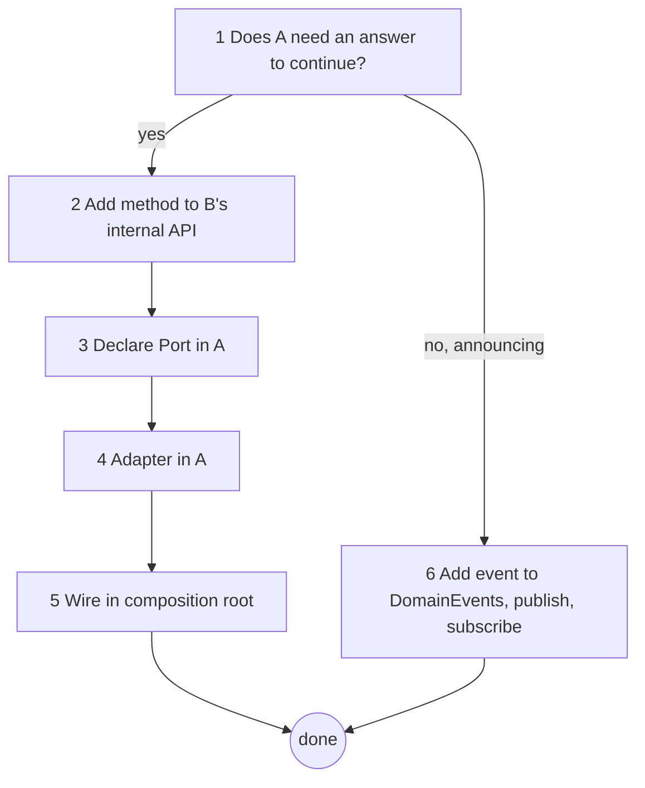

# Layered modular architecture (TypeScript)

## Scope

A modular monolith: three layers per module, narrow contracts between modules.

## Model

```
presentation  ──►  business  ◄──  infrastructure
   (in)             (core)            (out)
```

- **business** is the core: entities, use cases, and the *interfaces* for everything it needs
  (repositories, mailers, other modules). It imports nothing outside itself except `shared/errors.ts`
  and `shared/event-bus.ts`. No HTTP, SQL, ORM, SDK or DTOs.
- **presentation** holds every way *into* the module: HTTP controllers, event-bus subscribers,
  CLI/cron/queue entry points, and the internal API other modules call. It parses input, calls
  services, maps entities to DTOs and translates errors.
- **infrastructure** holds every way *out*: repository implementations, external clients, and adapters
  that call other modules. It implements business interfaces.

The arrows matter more than the folders. Interfaces live where they are *used* (business), so
infrastructure depends on business, never the other way round. If you find yourself importing
something "upward", stop: the interface is in the wrong place.

## General rules

- **GR1 Must** When the project deviates on purpose (different folder names, an existing DI container, a
  framework like NestJS with its own module system), follow the project and name the rule ID you adapt and
  why. Keep dependencies pointing one way and contracts narrow.

## Module layout

The folder tree is in `references/rules.md`, "Folder layout". It is the only copy.

## Example app

All paths are relative to `assets/example-app/`. Run `npm install && npm run check` there to typecheck,
run the architecture linter and the tests. `npm run demo` exercises the whole flow.

| To see how to… | Open |
|---|---|
| Structure a module's entry point (deps in, `{ routes, jobs, internal }` out) | `src/modules/users/index.ts` |
| Wire modules together | `src/composition-root.ts` |
| Write a use case with injected interfaces | `src/modules/orders/business/service/order.service.ts` |
| Test a use case with plain fakes | `src/modules/orders/business/service/order.service.test.ts` |
| Declare a repository interface / implement it | `users/business/port/repository/user.repository.ts` → `users/infrastructure/repository/in-memory-user.repository.ts` |
| Declare a capability interface / implement it | `notifications/business/port/mail/mailer.ts` → `notifications/infrastructure/mail/console-mailer.ts` |
| Write an HTTP controller + route table | `users/presentation/api/user.controller.ts`, `user.routes.ts` |
| Separate HTTP DTOs from internal DTOs | `users/presentation/dto/api/user.dto.ts` vs `users/presentation/dto/internal/user-summary.dto.ts` |
| Map entities to DTOs | `users/presentation/dto/mapper/user.mapper.ts` |
| Offer an internal API to other modules | `users/presentation/internal/users.api.ts` + `users.facade.ts` |
| Consume another module's API (anti-corruption adapter) | `orders/business/port/user/user.port.ts` (`UserPort`) → `orders/infrastructure/internal/users.adapter.ts` (`UsersAdapter`) |
| React to events from other modules | `notifications/presentation/bus/event-handlers.ts` |
| Publish an event | `orders/business/service/order.service.ts` (`bus.publish`) + `src/shared/event-bus.ts` (`DomainEvents`) |
| Enforce the rules automatically | `.dependency-cruiser.cjs` (rule IDs match the lint tags `[L1]`, `[B2]` … in rules.md) |

(`users/…`, `orders/…`, `notifications/…` are under `src/modules/`.)

## Enforcement

`assets/example-app/.dependency-cruiser.cjs` enforces the import rules (dependency-cruiser 16).
For a new project, copy it to the repo root, `npm i -D dependency-cruiser@16`, and add
`"lint:arch": "depcruise src --config .dependency-cruiser.cjs"`. If the project already uses these
folder names, it works unchanged. Run it (and `tsc`) after structural changes: every rule ID in its
output is a lint tag in `references/rules.md`.

## Steps

### Placing a single file

1. **Goal:** find the file's folder.
   - **Actions:** look it up in "What goes where" in `references/rules.md`. If nothing fits, ask by direction: a way *in* (presentation), a rule (business), or a way *out* (infrastructure).
   - **Done:** one folder named; an interface sits in the layer that uses it (BU3).

### Adding a use case or endpoint

1. **Goal:** place the domain change.
   - **Actions:** entity changes → `business/domain/`. Rules → a method on a service in `business/service/`.
   - **Done:** no rule lives outside `business/service/` (BU4, PR2).
2. **Goal:** persistence.
   - **Actions:** extend the interface in `business/port/repository/`, then the implementations in `infrastructure/repository/`.
   - **Done:** every interface method has an implementation.
3. **Goal:** the HTTP side.
   - **Actions:** request/response DTOs in `dto/api/`, mapper in `dto/mapper/`, controller method in `presentation/api/`, route in `<module>.routes.ts`.
   - **Done:** PR1, PR6 and PR7 hold.
4. **Goal:** split the checks.
   - **Actions:** shape checks in the controller, business rules in the service.
   - **Done:** PR2 holds.

### Deciding whether something is a new module

1. **Goal:** decide before writing code, most of all in an empty project, where folding everything into one or two modules "because nothing else needs it yet" is the pull.
   - **Actions:** test the feature against MC1–MC4 and MK1–MK3 in `references/rules.md`, "When to create a module"; run its Test and compare the case table.
   - **Done:** each MC and MK rule has a yes or no, and the decision is named.
   - **Output:** new module (→ Adding a module) or the existing module that keeps it.

### Splitting a class

1. **Goal:** split a service, repository or adapter when placing it, before writing it.
   - **Actions:** apply BU7 and BU8 to its methods and fields.
   - **Done:** each class passes BU7; BU8 is met or the odd group is its own class.

### Adding a module

1. **Goal:** build the module.
   - **Actions:** follow `### Adding a module` in `references/rules.md`, "Steps".
   - **Done:** its last step passes.

### Module A needs something from module B



1. **Goal:** pick sync call or event.
   - **Actions:** ask: does A need an answer to continue? (MB5)
   - **Done:** one answer.
   - **Exits:** yes → 2 · no, A announces something that happened → 6.
2. **Goal:** B offers the method.
   - **Actions:** add it to `presentation/internal/<b>.api.ts` with `dto/internal/` types or primitives; implement it in the facade by calling B's services, mapping with B's mapper.
   - **Done:** IA1, IA4, PR8 hold.
3. **Goal:** A declares what it needs.
   - **Actions:** one interface `<Thing>Port` in `business/port/<thing>/`, in A's vocabulary (orders has `UserPort.exists()`, not `UsersApi`). Add methods to the port, never a second one.
   - **Done:** BU3 holds.
4. **Goal:** A implements the port.
   - **Actions:** one `<B>Adapter` in `infrastructure/internal/<provider>-adapter.ts` (orders has `UsersAdapter`), importing only B's `index.ts`; constructor takes `Pick<BApi, …>`.
   - **Done:** IN3, IA5 and MB1 hold.
5. **Goal:** wire it.
   - **Actions:** add B's API type to A's factory deps; pass `b.internal.x` in `composition-root.ts`.
   - **Done:** WI2 and WI3 hold; WI5 holds (if A and B need each other, turn one direction into an event).
   - **Exits:** → done.
6. **Goal:** announce an event.
   - **Actions:** add the payload to `DomainEvents` in `shared/event-bus.ts`, publish from A's service, subscribe in B's `presentation/bus/`.
   - **Done:** MB6 holds.
   - **Exits:** → done.

### Dependency injection

1. **Goal:** wire classes by hand.
   - **Actions:** each module wires its own classes in `index.ts`; the composition root creates shared infrastructure, calls module factories and passes facades between them. Factories accept optional overrides (`repo?`, `mailer?`) for tests and other environments.
   - **Done:** WI1–WI4 and WI6 hold.

### Reviewing code

1. **Goal:** find breaches.
   - **Actions:** check imports against the dependency direction first; it catches most. Then the rules the linter cannot see: entities leaking through DTOs, business rules in controllers, facades going to repositories, module-specific errors escaping a facade, `index.ts` re-exporting business types.
   - **Done:** every finding cites `project-architecture <ID>`.

## Load also

None yet.
