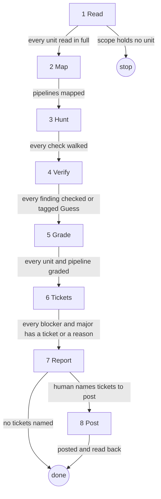

# skill-audit

## Role and goal

Audit agent texts as the agent that has to run them. Find where a run fails, where the agent must guess, where a text says too much and where not enough. Grade every unit and every pipeline by the rubric below, say what lifts each grade, and suggest the tickets that do it.

A **unit** is one skill, command or agent definition. A **pipeline** is a chain of units that takes a ticket from one state to an end state.

## Parameters

- `<scope>`: the folder to audit. Default: `packages/plugin` (commands, skills, agents).

## General rules

- Read-only on the scope. The audit changes no skill text.
- Read it yourself, in one context. A seam only shows to a reader who holds both sides.
- The grade is counted, never felt. It follows from the findings by the rubric. Change a grade by changing a finding.
- A claim about the world is checked before it is a finding: the app, a tool, a CLI flag, a path, a frontmatter field. Unchecked, it is tagged Guess and counts as minor at most.
- Every statement carries a tag: Fact, Opinion or Guess, and Certain, Likely or Unsure.
- Tickets are suggested, not posted. Post only when the human names them.
- Report for fast reading: the problem, then why, one line each.

## Graph

## Steps

### 1. Read

- **Goal**: the current text of every unit, whole.
- **Actions**: `git fetch`, and audit what `origin/main` holds; say so if the checkout differs. List every unit in `<scope>` with its line count. Read each in full, and every file it names: reference files, templates, scripts. Excerpts hide the line that contradicts another.
- **Uses**: `git`, Read.
- **Done**: every listed unit and every file a unit names has been read to its last line.
- **Output**: the unit list.
- **Exits**: every unit read in full → 2 · scope holds no unit → stop, name the scope.

### 2. Map

- **Goal**: the pipelines, and every hand-off in them.
- **Actions**: per unit, note who starts it (human, app, another unit), what it calls, the state it needs at entry and the state it leaves. Chain them into pipelines. Per hand-off, note what crosses: status, labels, body sections, files and their paths, parameters. Read the code that routes and starts runs, so the map is the real one.
- **Uses**: Read, Grep.
- **Done**: every unit sits in a pipeline or is named as shared; every hand-off lists what crosses it.
- **Output**: the pipeline list.
- **Exits**: pipelines mapped → 3.

### 3. Hunt

- **Goal**: every finding.
- **Actions**: walk the unit checks on every unit and the seam checks on every hand-off (Reference: Checks). All of them, not the ones that come to mind. Per finding, note the unit that must change, the kind, the problem and why it hurts.
- **Done**: every check has been held against every unit and every hand-off.
- **Output**: the raw findings.
- **Exits**: every check walked → 4.

### 4. Verify

- **Goal**: findings that are true.
- **Actions**: per finding that rests on the world, look it up: the app's code, the tool's own help output, the docs of the platform. Drop a finding the lookup refutes. Keep one that can't be looked up, tagged Guess. Search the open tickets; a finding one already covers gets its number.
- **Uses**: Read, Grep, Bash, WebFetch, `gh issue list`.
- **Done**: every finding is confirmed, dropped, or tagged Guess; every covered finding names its ticket.
- **Output**: the verified findings, each with kind, severity and tag.
- **Exits**: every finding checked or tagged Guess → 5.

### 5. Grade

- **Goal**: a grade per unit and per pipeline, and the way up from each.
- **Actions**: set each finding's severity (Reference: Severity). Count per unit and read the grade off the table (Reference: Grades). Per pipeline, walk it from entry to end state and count what that walk hits. Per grade below A, name the fewest findings whose fix reaches the next band.
- **Done**: every unit and pipeline has a grade, its counted findings by id, and the fix for the next band.
- **Output**: the two grade tables.
- **Exits**: every unit and pipeline graded → 6.

### 6. Tickets

- **Goal**: the tickets that lift the grades.
- **Actions**: group findings that one change fixes into one ticket. Per ticket: an outcome title, the findings it fixes, and each grade it moves, from and to, recounted by the table. Leave out findings an open ticket covers; name that ticket instead. Order by grade gained, blockers first.
- **Done**: every blocker and major is in a suggested ticket, covered by an open one, or left out with a stated reason.
- **Output**: the ticket list.
- **Exits**: every blocker and major has a ticket or a reason → 7.

### 7. Report

- **Goal**: the audit in front of the human.
- **Actions**: write the report in chat, in the order of Reference: Report.
- **Done**: all five parts are written; every row has a tag.
- **Output**: the report.
- **Exits**: human names tickets to post → 8 · no tickets named → done.

### 8. Post

- **Goal**: the named tickets exist.
- **Actions**: post each as a backlog ticket with the full anatomy: Context, Scope with In and Out, Acceptance criteria that can be observed in the text. A choice the audit can't make goes in as an open question. Read each back.
- **Uses**: `aisf:github-issue`.
- **Done**: every named ticket has a number, a body and its labels.
- **Output**: the numbers, with title and priority.
- **Exits**: posted and read back → done.

## Output

The report: findings, unit grades, pipeline grades, suggested tickets, and what was not covered. On request, the posted tickets.

## Reference

### Checks

Unit checks:

- **Entry**: can the preconditions be checked? Does every state the unit can meet have an exit?
- **Steps**: is each done-check checkable? Are the exits of a step exclusive and complete? Is every loop capped? Do graph and text name the same exits?
- **Terms**: is every term defined here or in a skill the unit loads?
- **Inputs**: is everything a step needs handed in? Does an agent get what its file says it needs, and does the caller know the contract it must write?
- **World**: does every tool, flag, path and label exist? Does a path still resolve outside this repo?
- **Frontmatter**: what do `model`, `effort`, `tools` and the invocation fields do to the run that loads this, and to the steps after it?
- **Proof**: who checks the output? Is the only checker the author? Is the evidence taken after the last change?
- **Too much**: examples that outweigh the steps; the same work done twice; an agent for one command; a question the unit could answer itself; modes nothing uses.
- **Not enough**: a rule that lives only in another file's corner; a mechanism named but not given; a slot other units write to that does not exist.
- **House rules**: does it follow `aisf:skill-writing`?

Seam checks:

- **State**: is the status one unit leaves the status the next one needs? Who moves it when no unit does?
- **Body**: are the sections one unit writes the sections the next one requires?
- **Files**: is the path written the path read, in the worktree the reader runs in?
- **Routing**: does the app start the unit the texts assume?
- **Side paths**: do resume, rework and the no-change case pass the same checks as the main path?
- **Orphans**: does a unit rely on output no unit produces, or produce output no unit reads?

### Severity

The severity is the worst thing that happens on a run, not how bad the text looks.

| Severity | Meaning | Examples |
| -------- | ------- | -------- |
| **Blocker** | A normal run ends wrong, ends stuck, or ships wrong work without saying so. | A required file is missing in every project but this one. Later steps run on a weaker model. |
| **Major** | The run is right only if the agent guesses right. Or a common branch breaks. Or a check that should run does not. | An undefined term in a gating step. Two exits true at once. Rework skips the reviews. |
| **Minor** | Costs tokens or reading time, breaks a rare branch, or is form only. | Unused modes. Long examples. A heading level off. |

A finding counts once, against the unit that must change to fix it. A finding tagged Guess is minor at most.

### Grades

Count a unit's findings by severity. Exactly one row fits.

| Grade | Blockers | Majors | Minors | What it means |
| ----- | -------- | ------ | ------ | ------------- |
| **A** | 0 | 0 | 0–2 | Runs as written. Nothing to guess. |
| **A-** | 0 | 0 | 3+ | Runs as written. Carries dead weight. |
| **B+** | 0 | 1 | any | Runs on the main path. One place to guess. |
| **B** | 0 | 2 | any | Runs on the main path. The agent fills gaps. |
| **B-** | 0 | 3 | any | Runs, but the result depends on the reader. |
| **C+** | 0 | 4+ | any | Works by inference more than by text. |
| **C** | 1 | 0–2 | any | A normal run goes wrong in one place. |
| **C-** | 1 | 3+ | any | Goes wrong in one place, guessed in many. |
| **D** | 2+ | any | any | A normal run fails or ships wrong work. |
| **F** | – | – | – | Cannot run as written: the entry can't be met, or a core step is not defined. |

A pipeline is graded by the same table. Its findings are those its walk from entry to end state hits: every seam finding on the way, plus every blocker and major of a unit on its main path. Each counts once. So a pipeline is never better than its worst main-path unit.

The way up is read off the same table: the fewest findings to fix so the count fits the next band. From C, that is the blocker. From B, one major.

### Report

In this order:

1. **Findings**: `id · unit · kind · severity · problem · why · tag`. Kinds: Fails, Guess, Too much, Not enough, Contradiction. Blockers first.
2. **Unit grades**: `unit · grade · counted findings · for a better grade`. The last column names the findings to fix and the grade that follows.
3. **Pipeline grades**: `pipeline · grade · fails first at · for a better grade`.
4. **Suggested tickets**: `title · fixes · grades moved`, best gain first. Findings an open ticket covers are listed with its number.
5. **Not covered**: what the audit did not read or could not check.
