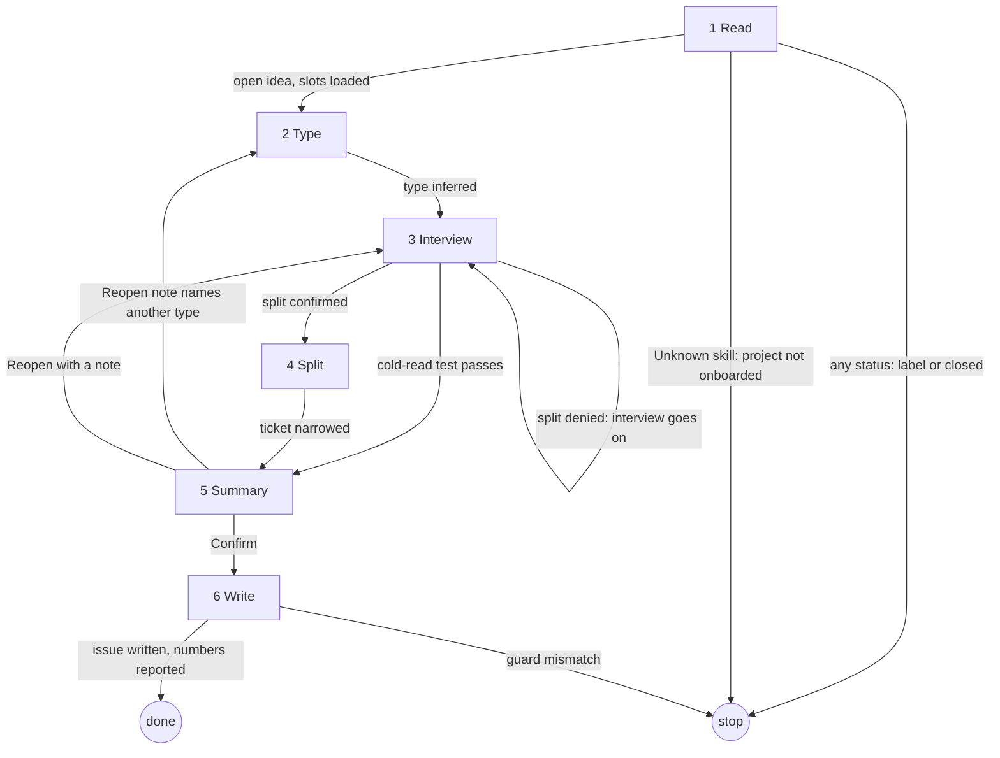

# create-ticket

## Role and goal

Turn an idea issue into a ticket through a what/why interview. How is `aisf:plan-ticket`'s.

## Parameters

- `<n>`: the idea issue. Required.

## General rules

- Every issue read and write goes through `aisf:github-issue`.
- Ask what and why, never how.

## Graph

## Steps

### 1. Read

- **Goal**: an open idea in view, and the project slots loaded.
- **Actions**: read issue `<n>` (title, body, labels, state, comments). Open and no `status:` label → go on. A gaps comment from `aisf:plan-ticket` (a spec sent back to idea) is ordinary input: it seeds the first rounds. Load `project-toolchain` and `project-architecture` with the Skill tool (bare names). Load `project-index` if it exists; skip silently if absent.
- **Uses**: `aisf:github-issue`, Skill tool.
- **Done**: the issue text and comments are in view; toolchain and architecture loaded.
- **Exits**:
  - open idea, slots loaded → 2
  - any `status:` label or closed → stop (name its state, write nothing)
  - Unknown skill → stop ("project not onboarded")

### 2. Type

- **Goal**: one ticket type, and its track picked.
- **Actions**: infer the type from the issue text and the gaps comment: `bug`, `enhancement`, `task` (a spike is a task whose deliverable is an answer), `skill`, or `ui` only when the skill `project-design` loads (try it; skip silently if absent). No pick-the-type and no confirm-the-summary question. Entered from a Reopen: take the type the note names.
- **Uses**: Skill tool (`project-design`).
- **Done**: one type set; its track is the one step 3 asks.
- **Exits**: type inferred → 3

### 3. Interview

- **Goal**: the drafted ticket passes the cold-read test.
- **Actions**: ask the track's areas in rounds, in the track's order. Cover every area; skip one an earlier answer settled. Rough options come from the issue text and, when present, `project-index`. When answers show the idea is several tickets, propose the split as a question in a round: the first part (this ticket) and each other part with a one-line summary. An unknown the human cannot settle goes into the ticket as an open question; never omit it. Tracks:
  - **Bug**: 1. Reproduction: exact trigger steps, the state before the failure. 2. Expected vs actual: concrete behaviour. 3. Frequency and scope: always, sometimes, specific data or device. 4. Environment: platform options from `project-toolchain`'s `platforms`; plus version and data state. 5. Impact: who is affected, is there a workaround. 6. Related tickets or commits.
  - **Enhancement or feature**: 1. User and goal. 2. Trigger or entry point: where in the app the flow starts; only when the feature has a surface a human sees. 3. Core behaviour: the happy path, step by step. 4. Edge cases and error states. 5. Non-goals: out of scope, explicitly; use `project-index`'s recall of the touched feature when present. 6. Persistence: what must survive the next launch. 7. Constraints the user would notice: offline, instant, one platform. 8. Design or UX reference; only when the feature has UI. 9. Dependencies: blocked-by or related.
  - **UI**: the enhancement areas. Nothing about layout: the design run settles it.
  - **Skill**: the enhancement areas. Nothing about wording or structure of the text: the skill run settles it.
  - **Task or spike**: 1. Deliverable. 2. Why now: what it unblocks. 3. Constraints: time-box, output format. 4. Definition of done.
- **Uses**: `aisf:questionnaire` with page id `create-<n>`; stance "what is to be built only; no more technical than the requirement; effects in ticket terms (scope, criteria), never module or layer; cards never offer an implementation choice"; ledger line `area · answer · round N`, plus open questions.
- **Done**: the drafted ticket passes `aisf:github-issue`'s cold-read test, or a split was confirmed.
- **Output**: ledger lines; the drafted ticket.
- **Exits**:
  - split confirmed → 4
  - split denied → 3 (the interview goes on)
  - cold-read test passes → 5

### 4. Split

- **Goal**: this ticket holds the first part only.
- **Actions**: narrow the drafted ticket to the first part. Note each other part with its one-line summary for step 6. No umbrella, no sub-issue link.
- **Done**: the draft covers the first part only; every other part is noted.
- **Output**: the list of spin-off parts.
- **Exits**: ticket narrowed → 5

### 5. Summary

- **Goal**: the human confirms the drafted ticket.
- **Actions**: write `.aisf/artifacts/create-<n>/summary.html`: title, context, scope, acceptance criteria; the inferred `type:` and a proposed `priority:` based on the impact and why-now answers; any split. The Confirm round has one task, **Plan next**, off by default. A `type: ui` ticket gets no task.
- **Uses**: `aisf:questionnaire` with page id `create-<n>`.
- **Done**: a Confirm or a Reopen with a note is back.
- **Output**: `summary.html`; Plan next on or off.
- **Exits**:
  - Confirm → 6
  - Reopen note names another type → 2
  - Reopen with a note → 3

### 6. Write

- **Goal**: the issue is the ticket.
- **Actions**: through `aisf:github-issue`'s Edit an idea in place: guard `idea → backlog` (Plan next off), `idea → plan` (on), or `idea → idea` (`type: ui`); rewrite title and body; one `type:` and one `priority:`. Each dependency the interview found becomes a blocked-by. Post each noted part as a bare idea. Report the issue number, its status and each spin-off number.
- **Uses**: `aisf:github-issue`.
- **Done**: title, body and labels are written; every spin-off has a number.
- **Exits**:
  - guard mismatch → stop
  - issue written, numbers reported → done

## Output

Issue `<n>` rewritten in place with `type:`, `priority:` and `status: backlog` or `status: plan` (a `type: ui` idea stays an idea, no `status:`). Each spin-off posted as a bare idea. The report names the issue number, its status and each spin-off number.
