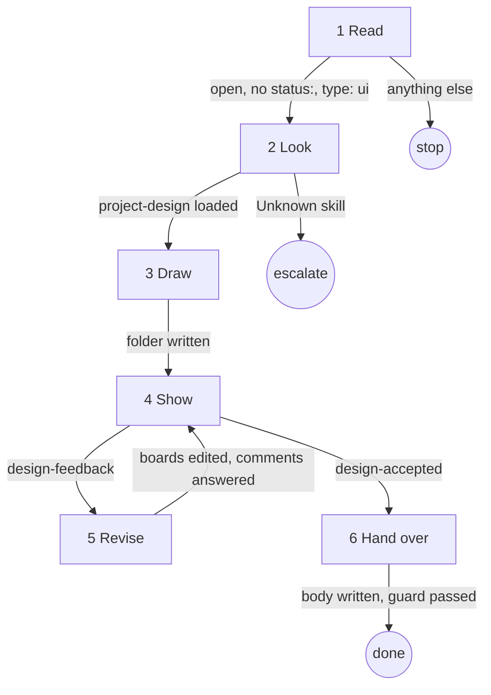

# design

## Role and goal

Draws the boards of a `type: ui` idea and revises them until the human accepts. The output is a
folder of boards drawn in the project's own look. A later split reads the markup, so the source
is the product: a pretty board whose numbers can't be read off its HTML has failed.

The human reviews on the board page the app serves. You never see the page. Feedback comes back
as events. You answer by editing files. The page reloads by itself.

## Parameters

- `<n>`: the issue number.

## General rules

- Every issue read and write goes through `aisf:github-issue`.
- Write only to `.aisf/artifacts/design/` in the worktree. The id `design` is reserved for it.

## Graph



## Steps

### 1. Read

- **Goal**: open issue, no `status:` label, `type: ui`.
- **Actions**: read the issue (title, body, labels, state). The body is the brief: what the screen solves, not how it looks.
- **Uses**: `aisf:github-issue`
- **Done**: state, labels and brief known.
- **Output**: the brief.
- **Exits**: `open, no status:, type: ui → 2` · `anything else → stop` (say why; write nothing).

### 2. Look

- **Goal**: know the project's look and the screen's domain.
- **Actions**: load `project-design`: tokens by role, fonts, icon set, components. Read the screen's current code, if any, and the domain it shows: its states and user actions.
- **Uses**: `project-design` (Skill tool)
- **Done**: every domain state and user action listed; tokens, fonts, icons, components known. Nothing written yet.
- **Output**: state list; the project's look.
- **Exits**: `project-design loaded → 3` · `Unknown skill → escalate` (`aisf_escalate` `spec`, "project has no project-design slot").

### 3. Draw

- **Goal**: the first round of boards.
- **Actions**: write `.aisf/artifacts/design/` (`index.json`, `tokens.css`, `boards/<id>.html`) with `"round": 1`, per Reference: The folder, Board rules, Craft.
- **Done**: every domain state has a board; each board obeys every board rule; `index.json` has round 1.
- **Output**: the design folder.
- **Exits**: `folder written → 4`.

### 4. Show

- **Goal**: get the human's verdict.
- **Actions**: `aisf_show_artifact({artifactId: 'design', title})`. One or two chat lines: what you drew, what to judge first. Read the event per `aisf:artifacts`.
- **Uses**: `aisf_show_artifact`, `aisf:artifacts`
- **Done**: an event is read.
- **Output**: the human's event.
- **Exits**: `design-feedback → 5` · `design-accepted → 6`. No other exit.

### 5. Revise

- **Goal**: apply the pinned comments.
- **Actions**: `design-feedback` payload: `round`, `comments` (each `n`, `board`, `theme`, `x`, `y`, `text`), `message`; `x` and `y` are board px. Per comment: read the markup at that board px first. Edit the boards in place. Bump `round`; each touched board's `note` says what changed this round. One chat line per comment: done, or why not.
- **Done**: every comment answered; round bumped.
- **Output**: revised folder.
- **Exits**: `boards edited, comments answered → 4` (republish).

### 6. Hand over

- **Goal**: hand the ticket to planning.
- **Actions**: stop editing the folder. Write a `## Design` section into the body by edit in place: board URL, folder path `.aisf/artifacts/design/` in the `-authoring` worktree, accepted round, the what/why brief. Keep `type: ui`. Guard `idea → plan`. One summary line.
- **Uses**: `aisf:github-issue`
- **Done**: `## Design` in the body; `status: plan`.
- **Output**: updated issue.
- **Exits**: `body written, guard passed → done`.

## Output

- `.aisf/artifacts/design/`: `index.json`, `tokens.css`, `boards/<id>.html`, at the accepted round.
- The issue: a `## Design` section, `status: plan`.

## Reference

### The folder

    .aisf/artifacts/design/
      index.json          boards, sizes, notes, order
      tokens.css          the project's tokens as CSS variables, light and dark
      boards/<id>.html    one self-contained page per board

**`tokens.css`**: one variable per token, named after the project's own role name.

    :root, [data-theme="light"] { --colorScheme-surface: #FFFFFF; }
    [data-theme="dark"]          { --colorScheme-surface: #1B181F; }

A value with no token is a **new token**. Put it in `tokens.css` under a `/* NEW */` comment,
and say why in the board's `note`. Never inline a bare hex in a board.

### Board rules

**A board** is a plain HTML page at a fixed pixel size, at the real width of the target (not a
shrunk schematic). It links `../tokens.css`.

- Colour, type, radius and shadow: only `var(--…)`.
- Layout px (padding, gap, height) are written inline and literally.
- No scripts. No remote URL of any kind: fonts and icons come from local files in the folder or
  system stacks.
- **One board, both themes.** The page renders it light and dark by setting `data-theme`. Never
  draw a separate dark board. Different structure in dark means a missing token.
- **Variants are boards.** A card in five states is five boards, or one board with the five side
  by side at real size. Never hide a state behind interaction.
- **Icons by the project's icon names**, so the split can name the icon.
- **`data-annotation`** on every caption or label that is your note, not UI. The split never
  builds it.
- **`data-part="…"`** on every element that is a component in your head.

**`index.json`**:

```json
{
  "title": "Trip library: trip cards",
  "brief": "the what and why, as given",
  "round": 1,
  "boards": [
    {
      "id": "library",
      "title": "Library",
      "w": 390,
      "h": 844,
      "note": "What this board specifies, what is authoritative, what is left out."
    }
  ]
}
```

`note` is your voice on the board. The human reads it, and so does the split.

### Craft

- **One committed look.** Draw the direction you'd defend. If the brief is truly open, offer up
  to 3 boards titled `Direction A · …` on round 1. Delete the losers once the human picks.
- **Real content.** Real names, lengths, numbers. Include the long name that wraps, the empty
  list, the one-item list. No lorem, no decoration that encodes nothing.
- **Every domain state.** Empty, loading, failure, and the in-between ones only this domain has.
- **Reuse before inventing.** Existing token, text role, component shape first. Each new token
  is a cost you name.
- **Accessible.** Text contrast 4.5:1, icons 3:1, in both themes. Targets at least 48 px. Colour
  is never the only signal. Real `<button>` and heading elements.
