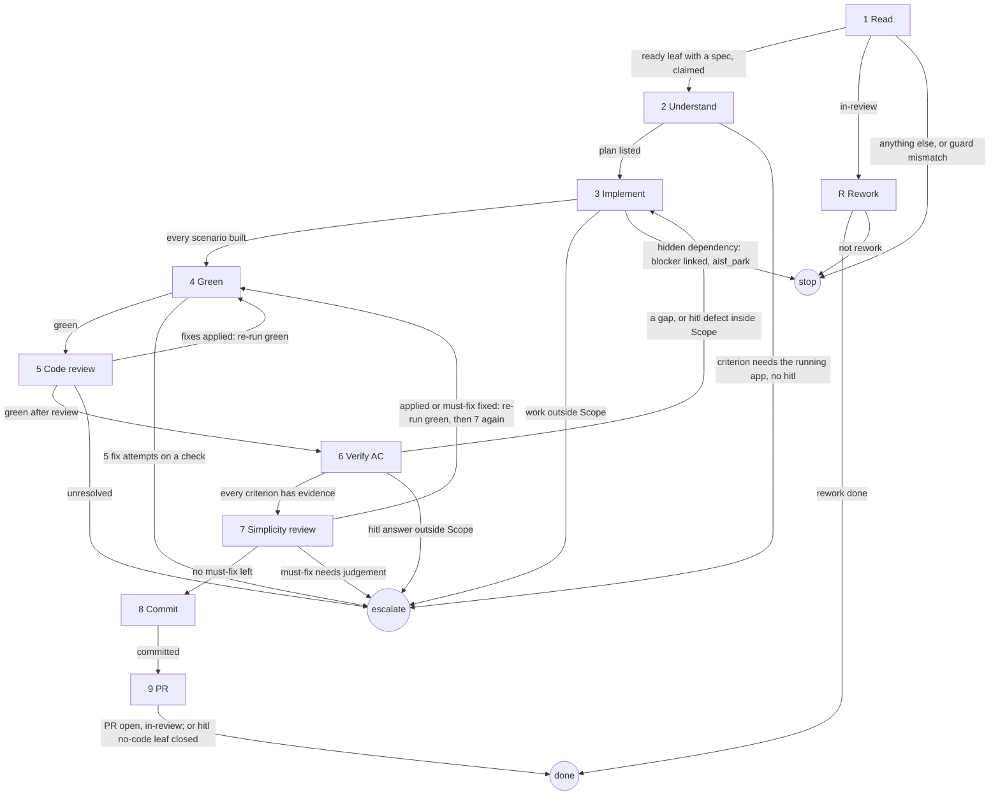

# implement-ticket

## Role and goal

Build one ready code leaf to an open PR, from the spec on the ticket alone. An `in-review` ticket goes to `aisf:rework`.

## Parameters

- `<n>`: the ticket.
- `--since <ISO time>`: passed on to `aisf:rework`.

## General rules

- The ticket is the whole brief. Through step 6, load no `project-architecture` or `project-index`, and read no parent's or sibling's body. `aisf:review-code` checks the architecture in step 5.
- Every status change and issue write goes through `aisf:github-issue`.
- Keep every test as strong as it is. Touch a PR only when green.
- A choice the ticket leaves open, or a contradiction in it, is a decision: make it, list it in the PR's Merge danger.

## Graph

Escapes inside `aisf:pr` and `aisf:rework` are not drawn: the owner's graph holds them.

## Steps

### 1. Read

- Goal: a ready code leaf with a spec, claimed; or an `in-review` ticket handed to rework.
- Actions: read the ticket. A leaf at `status: ready` with Scope, Landing zone and Acceptance criteria in its body (under `## Spec` on a one-PR ticket): guard `ready → in-progress`. `in-review` → R.
- Uses: `aisf:github-issue`.
- Done: the ticket is `in-progress`, handed to R, or the run stopped.
- Exits: ready leaf with a spec, claimed → 2 · `in-review` → R · anything else, or guard mismatch → stop: say why, write nothing.

### 2. Understand

- Goal: a plan of the build.
- Actions: load `aisf:tdd`. Read the ticket and the code its Landing zone names. List the files to touch, one test per scenario, and the proof for each criterion without behaviour. Settle every vague criterion's reading now.
- Uses: `aisf:tdd`.
- Done: every criterion has a test or a proof in the list.
- Exits: plan listed → 3 · a criterion needs the running app or a write outside the checkout, on a leaf without `hitl` → escalate `spec`.

### 3. Implement

- Goal: every scenario built, inside Scope.
- Actions: TDD per `aisf:tdd`. The spec's names, Landing zone and contracts go in verbatim: a sibling builds against them. Scope's Out belongs to a sibling. Hidden dependency (can't finish until another ticket lands): find or post a bare idea for it, `gh issue edit <n> --add-blocked-by <m>`, comment why, `aisf_park`.
- Uses: `aisf:tdd`, `aisf:github-issue`, `aisf_park`.
- Done: every scenario has a passing test.
- Exits: every scenario built → 4 · needed work outside Scope → escalate `spec` · hidden dependency, blocker linked → stop via `aisf_park`.

### 4. Green

- Goal: `test` and `analyze` clean.
- Actions: run `test` and `analyze` from `project-toolchain`; read `analyze` as its block says. 5 fix attempts per failing check; a new failure resets the count. Unsure a failure is yours → run the file in a throwaway `git worktree` on `origin/main`. Red there too → not yours: report it, post a bare idea if none exists.
- Uses: `project-toolchain`.
- Done: both clean.
- Exits: green → 5, or back to the step that sent here (5 → 6, 7 → 7) · 5 fix attempts on a check → escalate `red`.

### 5. Code review

- Goal: the architecture checked against the spec.
- Actions: launch one `aisf:review-code` agent whose prompt is the spec, verbatim, nothing else (on a one-PR ticket: the `## Spec` section). Fixed → nothing. Deviates from spec → each in the PR's Merge danger; a `contract` one also gets a comment on every sibling the spec names for it: old name and shape, new one, the rule. Re-run 4; keep its fixes.
- Uses: `aisf:review-code`.
- Done: its result handled, green.
- Exits: fixes applied → 4 · green after review → 6 · unresolved → escalate `spec`.

### 6. Verify AC

- Goal: evidence for every criterion.
- Actions: scenario → the passing test that asserts it, by name. Command → run it verbatim, show the output; never a test in its place. `hitl` checkpoint → finish every step the spec puts before it, then `aisf_checkpoint`. The request holds only what no test or command proves. An answer that confirms is the evidence. A defect inside Scope → fix, checkpoint again with a new request.
- Uses: `aisf_checkpoint` (`hitl` only).
- Done: every criterion has evidence.
- Output: the evidence for the PR.
- Exits: every criterion has evidence → 7 · a gap, or a `hitl` defect inside Scope → 3 · `hitl` answer outside Scope → escalate `spec`, quoting it.

### 7. Simplicity review

- Goal: the diff simplified.
- Actions: invoke `aisf:review-simplicity` and handle its report as it says.
- Uses: `aisf:review-simplicity`.
- Done: no must-fix left.
- Exits: applied, or must-fix fixed → 4, then 7 again · no must-fix left → 8 · must-fix needs judgement → escalate `spec`.

### 8. Commit

- Goal: one commit.
- Actions: invoke `aisf:commit`.
- Uses: `aisf:commit`.
- Done: committed.
- Exits: committed → 9.

### 9. PR

- Goal: the work shipped, the ticket findable.
- Actions: a `hitl` leaf whose spec names no code change → post the step 6 evidence as a ticket comment, close the ticket; no push, no PR. Otherwise invoke `aisf:pr` with the step 6 evidence.
- Uses: `aisf:pr`, `aisf:github-issue`.
- Done: PR open and ticket `in-review`; or the `hitl` no-code leaf closed.
- Exits: → done.

### R. Rework

- Goal: the in-review PR reworked, or left to review.
- Actions: load `aisf:rework` with `--since`. It drives, and uses steps 3, 4, 6 and 8 for its change, check, verify and commit.
- Uses: `aisf:rework`.
- Done: `aisf:rework` ended.
- Exits: rework done → done · not rework → stop.

## Output

An open PR and the ticket `in-review`; or a `hitl` leaf with no code change closed with its evidence; or a rework done.
