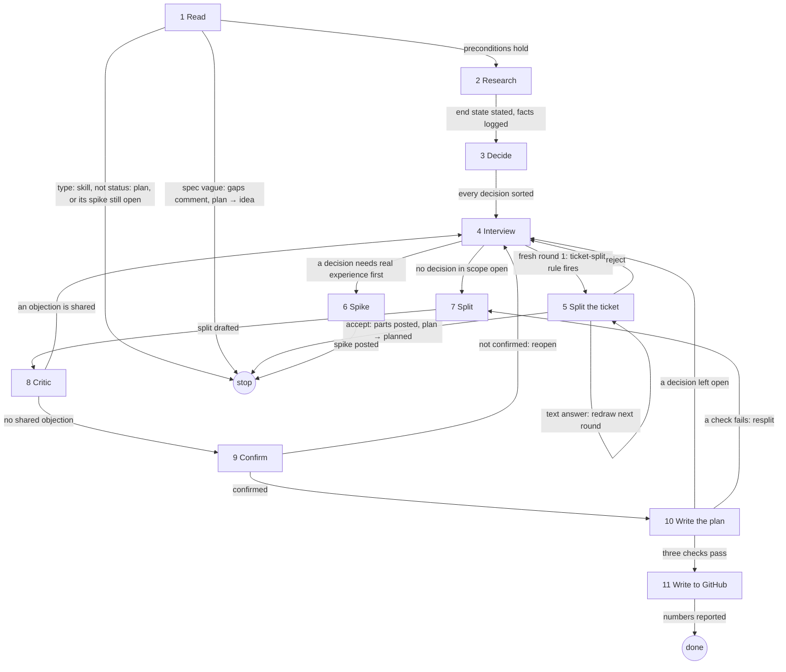

# plan-ticket

## Role and goal

Seat: senior developer in the project's stack. Turn a ticket at `status: plan` into a technical plan on the ticket and one spec per sub-issue, each buildable on its own by `aisf:implement-ticket`. Or split a too-big ticket into plan parts, or pause for a spike. The agent plans, the human decides.

## Parameters

- `<n>`: the ticket.

## General rules

- Every status change and issue write goes through `aisf:github-issue`.
- Every question goes through `aisf:questionnaire`, page id `plan-<n>`, stance "how it is built; technical detail encouraged". The caller's header is the playback map (`playback-builder`). Ledger line: `decision · answer · assumes: … · round N`.
- Never guess: underdefined → ask. Never make a feature decision alone, unless it follows directly from one already made.
- **Your seat.**
  - Enforce `project-architecture`'s rules and name every change in its terms.
  - Optimise for homogeneity: a second way to do what the project already does is a defect. Argue from precedent, citing code by name.
  - Prefer reduction to addition within the criteria.
  - Name the failure modes the criteria need, with their blast radius.
- **Scope** is the acceptance criteria. Test: would a criterion fail without this?
  - Yes → in scope. Work forced beyond a criterion's text is a necessary extension; its question names the reason ("AC2 fails without it").
  - No → not asked. One line under Out of scope, **Noticed, not planned**.
  - Skip every module, layer and phase the criteria need no change in.

## Graph

## Steps

### 1. Read

- **Goal**: project slots loaded; the ticket is `status: plan` with a clear spec.
- **Actions**: load `project-toolchain`, `project-architecture`, `project-testing` with the Skill tool, then every skill under their `## Load also`. Read the ticket. `## Planning so far` with its spike closed: it and the verdict seed the ledger; step 4 asks only what is open. Spec check: the body states a clear outcome and acceptance criteria.
- **Uses**: Skill tool, `aisf:github-issue`.
- **Done**: slots loaded, ticket read, spec checked.
- **Exits**:
  - preconditions hold → 2
  - `Unknown skill` → stop, "project not onboarded"
  - `type: skill` → stop, name `aisf:skill-ticket`, write nothing
  - not `status: plan` → stop, name the stage it needs
  - `## Planning so far` with its spike open → stop, name it
  - spec missing, vague or contradictory → comment the gaps, guard `plan → idea`, stop

### 2. Research

- **Goal**: the end state stated, every missing fact found.
- **Actions**: state the end state in a few sentences. Dispatch read-only research agents, one specific question each, before or between rounds; every prompt says "Do not edit files, commit, or open PRs — report findings only." Sources: codebase, high-trust primary web sources, projects the human names. Pattern research: per module with non-trivial business logic, one agent asks which design pattern fits ("none" is valid); it becomes a question only when a pattern is proposed. A dependency the project lacks is checked against `project-toolchain`'s dependency bar and becomes a question.
- **Uses**: research agents.
- **Done**: end state stated; every fact the decisions need is in `findings.md`.
- **Output**: `findings.md` lines.
- **Exits**: → 3

### 3. Decide

- **Goal**: every decision in scope sorted.
- **Actions**: list the decisions by phase, UI first:
  1. UI: area, states, actions, data needs; no frontend layering.
  2. Modules.
  3. Inbound contract: covers every UI data need.
  4. Business logic, plus pattern.
  5. Outbound interfaces and data.

  Sort each:
  - **question**: expensive to change or open to opinion, with rough options.
  - **settled by precedent**: one line, decision · source; the human may veto.
  - **spike call**: needs real experience; options, what settles them, whether the human judges.

- **Done**: every decision is a question, a precedent row or a spike call.
- **Output**: the question list and precedent rows.
- **Exits**: → 4

### 4. Interview

- **Goal**: no decision in scope open.
- **Actions**: rounds per `aisf:questionnaire`. Specific to planning:
  - Round 1 opens with the playback map: each criterion as a path through the touched UI and modules, by layer, new and changed parts marked. No Correct / Wrong path question.
  - A criterion whose playback needs two or more starting points gets a split question in round 1, a split proposal showing the proposed criteria. Accepted → rewrite the criteria in the body through `aisf:github-issue`. When the ticket-split rule fires (step 5), round 1 holds only that question; AC-split questions come in the round after a Reject.
  - The map stays current every round; a changed path is not asked again.
  - Phases shape the rounds; a later-phase question depending on nothing open may come early.
  - Settled rows are confirmed by submitting; a veto turns one into a question next round.
  - Pushback: at most once per answer, on one ground (hard ban or placement breach, a second way, more than the criteria need, a named failure mode), as a pushback card. Reaffirmed → the ledger line gets `· pushback: round M, reaffirmed`, never pushed again, listed under Risks as a knowing override.
  - Reopen: an answer contradicting a settled `assumes:` or changing a layer an earlier phase settled reopens that decision next round, naming the answer. Re-scan once per round.
- **Uses**: `aisf:questionnaire`, `aisf:github-issue`.
- **Done**: every criterion has its flow, landing module and data settled in the ledger.
- **Output**: ledger.
- **Exits**:
  - fresh round 1 (never a spike resume) and the ticket-split rule fires → 5
  - a decision needs real experience first → 6
  - no decision in scope open → 7

### 5. Split the ticket

- **Goal**: a ticket of several independent features posted as plan parts.
- **Actions**: split when the ticket asks for two or more features, each enhancing the app and usable completely without the others. One big feature is never split here; no token or count threshold. Round 1 holds the playback map and one split question (a split proposal): each part with title, drafted Context and Scope from `<n>`'s text, and `<n>`'s criteria regrouped verbatim and numbered (A1, A2, B1 …). A criterion touching several parts goes to each; new criteria only from the human's note. Accept → check each part body against the spec check and the cold-read test, post through `aisf:github-issue` mode Split part, guard `plan → planned`, report every part number and that each needs its own plan run.
- **Uses**: `aisf:questionnaire`, `aisf:github-issue`.
- **Done**: the human accepted, rejected or answered in text.
- **Exits**:
  - accept, parts posted → stop
  - reject → 4, with the usual round-1 questions
  - text answer → 5, redraw next round, nothing posted

### 6. Spike

- **Goal**: planning paused on a spike.
- **Actions**: post a `type: spike` sub-issue through `aisf:github-issue`: the options, what result settles them, that its verdict goes into this ticket's `## Planning so far`; `hitl` only when the human confirmed they judge the result. Write the ledger into the body as `## Planning so far`, ending `Waiting for the verdict of #<spike>`. The ticket stays `status: plan`.
- **Uses**: `aisf:github-issue`.
- **Done**: spike posted, Planning so far written.
- **Output**: the spike number, reported with "`aisf:spike` runs it".
- **Exits**: → stop

### 7. Split

- **Goal**: the draft split into sub-issues.
- **Actions**:
  - All frontend becomes one UI sub-issue for the design path, blocked by every backend sub-issue it reads from.
  - Backend is cut by module, then layer: infrastructure → business → presentation; provider facade before consumer adapter; port exception; wiring-only layers may merge, as a question.
  - Any other cross-module or cross-layer sub-issue is cut again; an exception is a question, an agreed one is a knowing override.
  - Skill part: work of `type: skill` becomes one `type: skill` child, blocked by every sub-issue it needs. An all-skill ticket of another type gets an umbrella with that one child. Fields: Title · Scope · Blocked-by · Proves, `hitl` off.
  - Per sub-issue: Title · Module · Layer · Scope · Blocked-by · Proves · `hitl` proposed.
  - A criterion that needs the running app or a real external write goes to a `hitl` sub-issue only; a check a scenario can state is a scenario.
  - Every `hitl` checkpoint is a question; only an agreed one goes into a spec.
  - No umbrella: fits one PR with no UI; UI only.
- **Done**: every criterion is proven by a sub-issue in the draft.
- **Output**: the draft split.
- **Exits**: → 8

### 8. Critic

- **Goal**: objections to the split found.
- **Actions**: one read-only critic agent (say so in the prompt) with the ticket body, the ledger, the draft split and the three slots; it may read the code. It hunts: a hard-ban or placement breach, a second way, a criterion no sub-issue proves, a flow step ending nowhere, a decision taken without the human, work no criterion needs. A rejected objection goes to Risks with the reason.
- **Uses**: critic agent.
- **Done**: every objection is shared or rejected.
- **Exits**:
  - an objection is shared → 4, as a question next round
  - no shared objection → 9

### 9. Confirm

- **Goal**: the human confirms the split and the `hitl` flags.
- **Actions**: the last round, per `aisf:questionnaire` (Confirm). One task per sub-issue: heading `<Title> · <module> · <layer>` (skill child `<Title> · skill`), its blocked-by, its proposed `hitl`. Tasks only, no decision tree. Confirm locks the `hitl` flags. The only gate besides an accepted ticket split.
- **Uses**: `aisf:questionnaire`.
- **Done**: confirmed or reopened.
- **Exits**:
  - confirmed → 10
  - not confirmed → 4, reopening that decision

### 10. Write the plan

- **Goal**: the plan and every spec, passing three checks.
- **Actions**: write from the ledger and findings. Plan template: Architecture and data flow · Tools and libraries · Practices and tests · Risks · Out of scope · Acceptance criteria · Sub-issues. Backend spec per `spec-template.md`. UI spec: what is shown, states, actions, the API contract; no layout, files or Given/When/Then. Skill child: a ticket body (Context, Scope, Acceptance criteria, the parent criterion it serves). Name what crosses a boundary; pin what is expensive or human-decided; a broken flow is fixed here. Three checks, once:
  - seams match
  - file coverage
  - no criterion unproven
- **Uses**: `spec-template.md`.
- **Done**: the three checks pass.
- **Output**: the plan document.
- **Exits**:
  - a decision the plan leaves open → 4, as a question
  - a check fails → 7, resplit, then 8 and 9 again
  - three checks pass → 11

### 11. Write to GitHub

- **Goal**: the plan on the ticket, every sub-issue posted.
- **Actions**: append `## Technical plan` to the body, replacing `## Planning so far`. Post sub-issues through `aisf:github-issue`; title from the `####` line, body the spec as is. Backfill real numbers into a new file. Guard `plan → planned`.
  - Fits one PR: plan plus `## Spec` on the ticket, guard `plan → ready`.
  - UI only: the UI spec goes on the ticket, its type becomes `type: ui`, guard `plan → backlog`; with `project-design`, `plan → idea`.
- **Uses**: `aisf:github-issue`.
- **Done**: plan on the ticket, every sub-issue posted, status moved.
- **Output**: report of every number and what `aisf:implement-ticket` picks up next. For a UI ticket: with `project-design` it starts its design run by itself, else it needs a design before `aisf:ui-ticket <n>`.
- **Exits**: → done

## Output

The plan on the ticket and one spec per sub-issue; or plan parts under `<n>`; or a spike with `## Planning so far`. And a report of every number.
