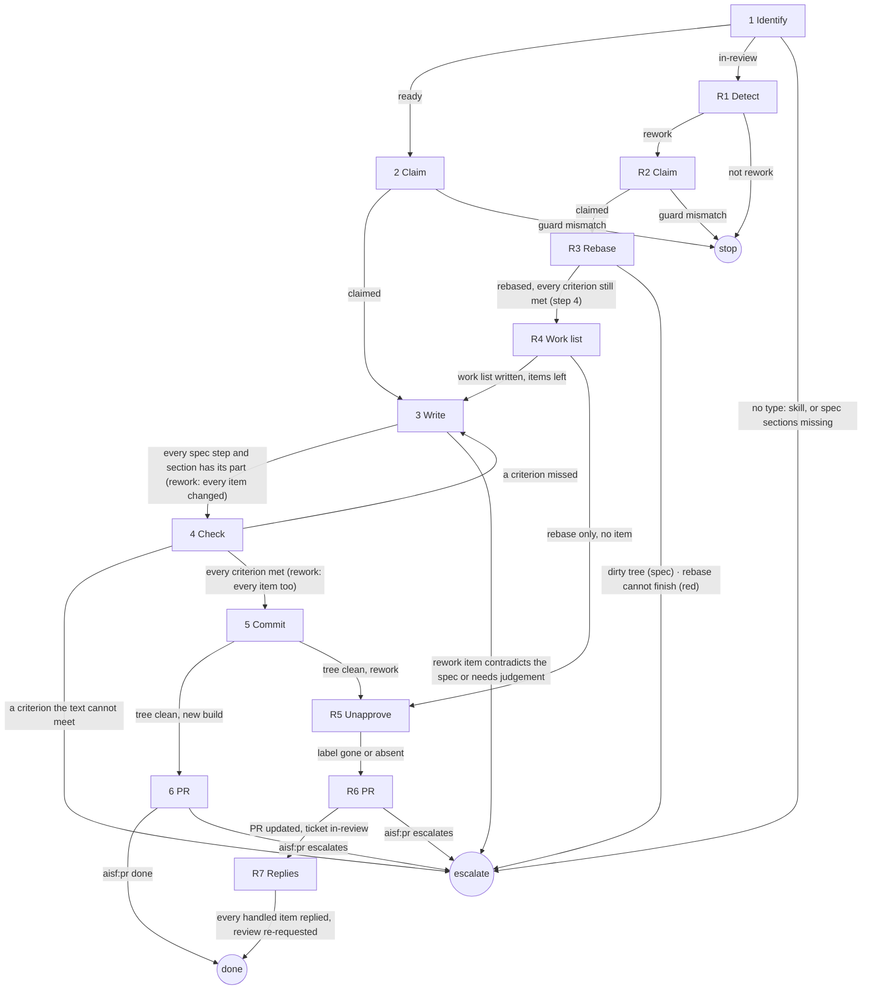

# skill-implement-ticket

## Role and goal

You are a senior skill author. Build one ready `type: skill` leaf to a PR, from its spec alone. An `in-review` ticket is reworked by steps R1–R7: every rework change passes 3 Write → 4 Check → 5 Commit. You write the text; the spec describes behaviour.

## Parameters

- `<n>`: the ticket.
- `--since <ISO time>`: when the app's last run ended. Only R1 and R4 use it.

## General rules

- The app runs you in the ticket's worktree on `aisf/<n>-<slug>`.
- Every issue write and status change goes through `aisf:github-issue`.
- No step waits for a human.
- Rework: rebase, never merge `origin/main` in: a merge commit blocks the app's rebase-merge.
- Rework: a review thread is the reviewer's to resolve.
- Rework: one commit per rework run. Items stay uncommitted through 3 → 4; step 5 commits them once.

## Graph

## Steps

### 1. Identify

- **Goal**: a `type: skill` leaf with a full spec; the mode known.
- **Actions**: read the ticket's title, body and labels. The required body sections are Context, Skill, Role and goal, Acceptance criteria, and `## Steps` or `## Sections` or both. Mode: `status: ready` → new; `status: in-review` → rework.
- **Uses**: `aisf:github-issue`.
- **Done**: `<n>` and the mode (new / rework) said.
- **Output**: the spec.
- **Exits**: ready → 2 · in-review → R1 · no `type: skill` → escalate `spec`, naming the label it has · body lacks Context, Skill, Role and goal or Acceptance criteria, or has neither Steps nor Sections → escalate `spec`.

### 2. Claim

- **Goal**: the ticket is `in-progress`.
- **Actions**: guarded `ready → in-progress`.
- **Uses**: `aisf:github-issue`.
- **Done**: the ticket is `in-progress`.
- **Exits**: claimed → 3 · guard mismatch → stop.

### 3. Write

- **Goal**: every file at the spec's Path lines.
- **Actions**: read `aisf:skill-writing`. Write the frontmatter per the spec's Invocation, then one file section per spec step, and one per spec section, each ending on its done-check. A spec with several paths: write every listed file. Rework: the R4 work list is the scope: change the text for every item, per `aisf:skill-writing`.
- **Uses**: `aisf:skill-writing`.
- **Done**: every spec step and every spec section has its part in the file, every listed path is written, every spec Output exists. Rework: every item changed.
- **Output**: the changed files.
- **Exits**: done → 4 · rework item contradicts the spec or needs a judgement call → escalate `spec`.

### 4. Check

- **Goal**: every acceptance criterion met by the text.
- **Actions**: read the changed text against every acceptance criterion of the spec, one by one. A spec gap found while writing shows here as a criterion the text cannot meet. Rework: every work-list item gets the line that handles it, named, beside the criteria.
- **Done**: each criterion has the line that meets it, named. Rework: every item has its line.
- **Output**: criterion → line list (the PR's Evidence).
- **Exits**: a criterion missed → 3 · a criterion the text cannot meet → escalate `spec` · every criterion met → 5.

### 5. Commit

- **Goal**: one commit (rework: one per run, holding every item).
- **Actions**: invoke `aisf:commit`.
- **Uses**: `aisf:commit`.
- **Done**: the tree is clean.
- **Exits**: tree clean, new build → 6 · tree clean, rework → R5.

### 6. PR

- **Goal**: the PR open, the ticket `in-review`.
- **Actions**: load `aisf:pr`, with step 4's criterion → line list as Evidence.
- **Uses**: `aisf:pr`.
- **Done**: `aisf:pr` is done.
- **Output**: the PR.
- **Exits**: `aisf:pr` done → done · `aisf:pr` escalates → escalate.

### R1. Detect

- **Goal**: decide whether the in-review ticket is rework.
- **Actions**: find the PR via `closedByPullRequestsReferences`. It is rework when exactly one open PR exists, it has no `approved` label unless it conflicts, and at least one holds:
  - it conflicts with `origin/main` (GitHub `mergeable` is `CONFLICTING`; `UNKNOWN` counts as no conflict, as in the app),
  - it has review activity after `--since` (a review with text or comments, or a PR conversation comment); without `--since` this trigger does not apply,
  - it has unresolved review threads.
- **Uses**: `aisf:github-issue` (issue read), `gh pr view`, `gh api graphql` (`reviewThreads`).
- **Done**: rework or not rework is decided.
- **Output**: the PR number, and which triggers hold.
- **Exits**: rework → R2 · not rework → stop, write nothing: it waits on review.

### R2. Claim

- **Goal**: the ticket is `in-progress`.
- **Actions**: guarded `in-review → in-progress`.
- **Uses**: `aisf:github-issue`.
- **Done**: the ticket is `in-progress`.
- **Exits**: claimed → R3 · guard mismatch → stop.

### R3. Rebase

- **Goal**: the current branch rebased on `origin/main`, every acceptance criterion still met.
- **Actions**: `git status --porcelain`; non-empty → escalate `spec`, naming the dirty files. Else `git fetch origin`, `git rebase origin/main` on the current branch. Then step 4 Check's actions.
- **Uses**: `git`, step 4 Check, `aisf_escalate`.
- **Done**: the branch is rebased and every criterion still has its line.
- **Output**: the rebased branch.
- **Exits**: rebased, every criterion still met → R4 · dirty tree → escalate `spec` · rebase cannot finish → escalate `red`.

### R4. Work list

- **Goal**: every review item listed; the list is the scope of this rework run.
- **Actions**: list each unresolved review thread (keep each comment's `databaseId`), each review body and PR conversation comment created after `--since` (none without `--since`), failing checks, conflicts. A rebase alone is no item.
- **Uses**: `gh api graphql` (`reviewThreads`), `gh pr view`, `gh pr checks`.
- **Done**: every item is on the list.
- **Output**: the work list.
- **Exits**: work list written, items left → 3 · rebase only, no item → R5.

### R5. Unapprove

- **Goal**: the human re-approves the reworked PR. The app auto-merges an `in-review` PR with `approved`, so the label must go before R6 moves the ticket to `in-review`.
- **Actions**: if the PR has the `approved` label: `gh pr edit <pr> --remove-label approved`.
- **Uses**: `gh`.
- **Done**: the PR has no `approved` label.
- **Exits**: label gone or absent → R6.

### R6. PR

- **Goal**: the PR updated in place and the ticket `in-review`.
- **Actions**: load `aisf:pr` as a rework run, with the evidence from step 4 (criterion → line list). It pushes with lease, rewrites the body and keeps `Closes #<n>`, and moves the ticket to `in-review`. No new PR.
- **Uses**: `aisf:pr`.
- **Done**: `aisf:pr` is done: PR updated, ticket `in-review`.
- **Output**: the PR URL.
- **Exits**: PR updated, ticket in-review → R7 · `aisf:pr` escalates → escalate.

### R7. Replies

- **Goal**: every reviewer knows what changed, by the rework commit's SHA, which is on GitHub.
- **Actions**: reply under each handled review comment with what changed for it and the rework commit's SHA (`gh api repos/{owner}/{repo}/pulls/<pr>/comments/<databaseId>/replies -f body=…`). A handled review body or conversation comment gets one PR comment quoting it, with the SHA. Re-request review from every reviewer whose item was handled. A rebase-only run has no item and no reply.
- **Uses**: `gh api`, `gh pr edit --add-reviewer`.
- **Done**: every handled item has a reply, and review is re-requested from each of their reviewers.
- **Output**: the replies.
- **Exits**: every handled item replied → done.

## Output

The skill file written per the spec, committed, and `aisf:pr` done: one open PR, ticket `in-review`. Or a rework done: the PR updated in place (rebased, one rework commit, pushed with lease, body rewritten), no `approved` label, a reply per handled item with the rework SHA, review re-requested, the ticket `in-review`. Not rework: nothing written.
