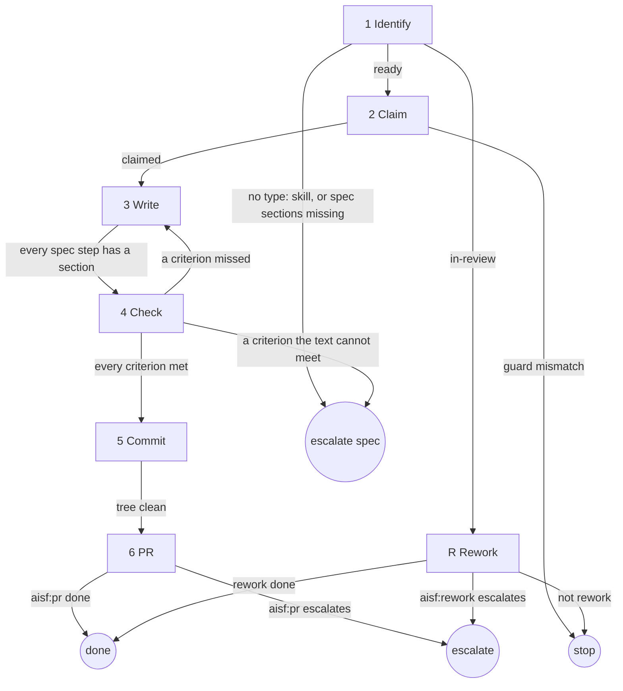

# skill-implement-ticket

## Role and goal

You are a senior skill author. Build one ready `type: skill` leaf to a PR, from its spec alone. You write the text; the spec describes behaviour.

## Parameters

- `<n>`: the ticket.
- `--since <ISO time>`: passed on to `aisf:rework`.

## General rules

- The app runs you in the ticket's worktree on `aisf/<n>-<slug>`.
- Every issue write and status change goes through `aisf:github-issue`.
- No step waits for a human.

## Graph

## Steps

### 1. Identify

- **Goal**: a `type: skill` leaf with a full spec; the mode known.
- **Actions**: read the ticket's title, body and labels. Mode: `status: ready` → new; `status: in-review` → rework.
- **Uses**: `aisf:github-issue`.
- **Done**: `<n>` and the mode (new / rework) said.
- **Output**: the spec.
- **Exits**: ready → 2 · in-review → R · no `type: skill` → escalate `spec`, naming the label it has · body lacks Context, Skill, Role and goal, Steps or Acceptance criteria → escalate `spec`.

### 2. Claim

- **Goal**: the ticket is `in-progress`.
- **Actions**: guarded `ready → in-progress`.
- **Uses**: `aisf:github-issue`.
- **Done**: the ticket is `in-progress`.
- **Exits**: claimed → 3 · guard mismatch → stop.

### 3. Write

- **Goal**: the file at the spec's Path.
- **Actions**: read `aisf:skill-writing`. Write the frontmatter per the spec's Invocation, then one section per spec step, each ending on its done-check.
- **Uses**: `aisf:skill-writing`.
- **Done**: every spec step has a section and every spec Output exists.
- **Output**: the changed file.
- **Exits**: every spec step has a section → 4.

### 4. Check

- **Goal**: every acceptance criterion met by the text.
- **Actions**: read the changed text against every acceptance criterion of the spec, one by one. A spec gap found while writing shows here as a criterion the text cannot meet.
- **Done**: each criterion has the line that meets it, named.
- **Output**: criterion → line list (the PR's Evidence).
- **Exits**: a criterion missed → 3 · a criterion the text cannot meet → escalate `spec` · every criterion met → 5.

### 5. Commit

- **Goal**: one commit.
- **Actions**: invoke `aisf:commit`.
- **Uses**: `aisf:commit`.
- **Done**: the tree is clean.
- **Exits**: tree clean → 6.

### 6. PR

- **Goal**: the PR open, the ticket `in-review`.
- **Actions**: load `aisf:pr`, with step 4's criterion → line list as Evidence.
- **Uses**: `aisf:pr`.
- **Done**: `aisf:pr` is done.
- **Output**: the PR.
- **Exits**: `aisf:pr` done → done · `aisf:pr` escalates → escalate.

### R. Rework

- **Goal**: the in-review PR reworked, or left alone when it is not rework.
- **Actions**: load `aisf:rework` with `--since`. It drives. Its change step is 3 Write, its check and verify steps are 4 Check, its commit step is 5 Commit.
- **Uses**: `aisf:rework`.
- **Done**: `aisf:rework` is done or stopped.
- **Exits**: rework done → done · not rework → stop · `aisf:rework` escalates → escalate.

## Output

The skill file written per the spec, committed, and `aisf:pr` done: one open PR, ticket `in-review`.
