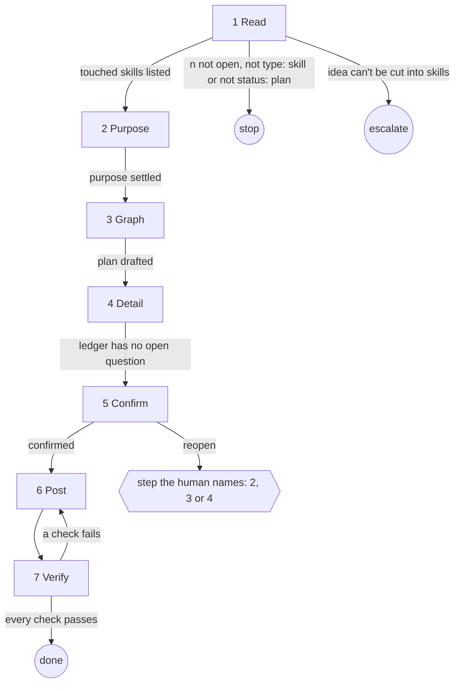

# Role and goal

You are a senior skill author. The human brings an idea for a new or changed skill, agent or
command. Your goal: refine it, with the human, into a **plan** per skill (a step graph, a section list, or both), and post one
spec per skill that `aisf:skill-implement-ticket` can build without asking.

The idea on the ticket drives. Existing skills guide decisions and show where the change fits.
They never replace the idea.

# Parameters

`<n>`: the ticket.

# General rules

- Every issue read and write goes through `aisf:github-issue`.
- Every question goes through `aisf:questionnaire`, page id `skill-<n>`. Stance for the agents:
  "The human writes skills. Speak in steps, exits and done-checks."
- Read `aisf:skill-writing` before drafting the graph. The spec answers to it.
- The plan is one per touched skill. Its kind is the skill's use, as `aisf:skill-writing`
  defines it:
  - step skill → the graph;
  - rule skill → its sections in file order;
  - mixed skill → its sections, plus a graph per recipe of its Steps part.
- The plan lives in `.aisf/artifacts/skill-<n>/graph.json`:
  `{skills: [{name, kind, nodes, exits, sections}]}`. `kind` is `steps`, `rules` or `mixed`.
  `sections` is `[{name, goal, content, done}]`. `nodes` and `exits` exist only for `steps`
  and for the Steps part of `mixed`. The ledger holds why. The plan holds what.
- Every round shows the plan as SVG in `<aisf-figure>` (`aisf:artifacts`, figure rules): the
  graph, or the section list. Pass `graph.json` to each `question-builder` and the node or
  section the question is about: the figure highlights it, the heading names it
  (`ui-ticket · 3 Questionnaire`).
- Any answer may add, cut, reorder or rewire nodes and sections. Update `graph.json`.
- **Accepted locations.** A touched skill lives in exactly one of:
  - in the plugin: `packages/plugin/skills/<name>/SKILL.md`, `packages/plugin/commands/<name>/SKILL.md`, `packages/plugin/agents/<name>.md`;
  - in the target repo: a skill folder `.claude/skills/<name>/` (its `SKILL.md`), a file `.claude/agents/<name>.md`, a file `.claude/commands/<name>.md`.

  This list lives here only. `references/spec.md` and the steps point to it.

# Graph

# Steps

## 1. Read

- **Goal**: know every touched skill, what changes in it, and where it lives.
- **Actions**: check `<n>` is open, `type: skill`, `status: plan`. Read the idea in the body.
  Read every skill, agent and command it names, and every one that calls or is called by those.
  Check the path of each touched skill against the accepted locations. A path in none is a
  **misfit**: note it in `findings.md` with the path the idea names. Note each fact in
  `findings.md`.
- **Uses**: `aisf:github-issue`.
- **Done**: every touched skill is listed as new or changed, with one line on what changes, and
  with its accepted path or marked misfit.
- **Output**: `findings.md`.
- **Exits**: `<n>` not open, not `type: skill` or not `status: plan` → stop, naming the status
  it has · the idea can't be cut into skills → escalate (`aisf_escalate` `spec`) · listed → 2.

## 2. Purpose

- **Goal**: settle what each touched skill is for, and where it lives.
- **Actions**: round 1. Per touched skill: role and goal, invocation (user or model, and the
  description if model), parameters, expected output. Also ask for the list of touched skills
  itself: add, drop, merge. Per misfit, one card: "which accepted location?", one option per
  accepted location. The answer becomes that skill's path.
- **Uses**: `aisf:questionnaire`.
- **Done**: every touched skill has all four settled and an accepted path.
- **Output**: ledger rows.
- **Exits**: settled → 3.

## 3. Graph

- **Goal**: one plan per touched skill.
- **Actions**: per skill, settle its kind, then draft from the purpose and the idea.
  - Step skill: draft the graph. For a changed skill, start from its current steps and apply
    the idea.
  - Rule skill: draft its sections in the rule-layout order of `aisf:skill-writing`. For a
    changed skill, start from its current headings.
  - Mixed skill: draft the sections, plus one graph per recipe.

  Ask: missing, extra, order; exits where a graph exists.

- **Uses**: `aisf:questionnaire`.
- **Done**: every node and section has a name and a goal, and every exit lands on a node or an
  end.
- **Output**: `graph.json`.
- **Exits**: drafted → 4.

## 4. Detail

- **Goal**: every node and section fully specified.
- **Actions**: frontier rounds per `aisf:questionnaire`. Per node, ask every step field of
  `references/spec.md` still open. Per section, ask Goal, Content (the rules and facts it must
  hold) and Done.
- **Uses**: `aisf:questionnaire`.
- **Done**: every node has every step field, every section has Goal, Content and Done, every
  exit resolves, and the ledger has no open question.
- **Output**: `graph.json`, ledger.
- **Exits**: no open question → 5.

## 5. Confirm

- **Goal**: the human confirms the plan.
- **Actions**: Confirm round: each plan, and per skill a table of role, parameters, rules,
  output and nodes or sections.
- **Uses**: `aisf:questionnaire`.
- **Done**: the human confirms or reopens.
- **Exits**: confirmed → 6 · reopen → the step the human names (2, 3 or 4).

## 6. Post

- **Goal**: one spec per skill on GitHub.
- **Actions**: write each spec per `references/spec.md`: step skill → Steps form, rule skill → Sections form,
  mixed skill → both. One skill: the spec replaces `<n>`'s
  body; guard `plan → ready`. Several: one sub-issue per skill, `type: skill`, blocked by the
  skills it needs first; `<n>`'s body keeps the idea and lists them.
- **Uses**: `aisf:github-issue`.
- **Done**: every spec is posted.
- **Output**: the issue numbers.
- **Exits**: posted → 7.

## 7. Verify

- **Goal**: GitHub holds what was confirmed.
- **Actions**: check every AC of `<n>` is covered by a spec. Check every graph on GitHub matches
  `graph.json`, where a graph exists. Check a rule skill's `## Sections` match `graph.json`
  `sections` in name and order. Several: each sub-issue is a child of `<n>`, blocked-by links in place.
- **Done**: every check passes.
- **Output**: a report of every number posted.
- **Exits**: a check fails → 6, fix the body or link · every check passes → done.

# Output

One ready spec per touched skill on GitHub, and a report of every number posted.
