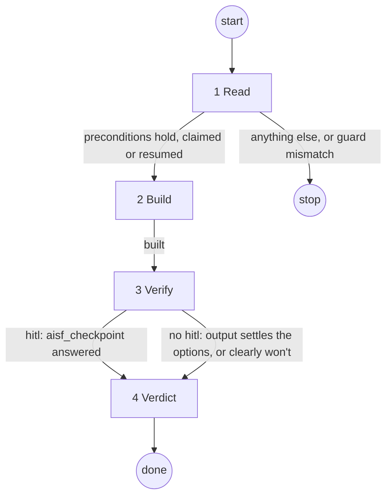

# spike

## Role and goal

Answer one spike ticket's question with throwaway code, so planning on its parent can go on.

## Parameters

- `<n>`: the spike ticket. If none, ask.

## General rules

- Every status change and issue write goes through `aisf:github-issue`.
- The run is on its own branch. Uncommitted work in the tree is this spike's: build on it.

## Graph

## Steps

### 1. Read

- **Goal**: an open `type: spike` whose parent has `## Planning so far`; know its options and what settles them; own the ticket.
- **Actions**: read the ticket (title, body, labels, state, parent). Take from the body the options and the result that settles them. At `status: ready`: guard `ready → in-progress`. At `status: in-progress` (resume): no guard.
- **Uses**: `aisf:github-issue`.
- **Done**: options and settling result named; ticket is `in-progress`.
- **Exits**: preconditions hold and claimed or resumed → 2 · anything else, or guard mismatch → stop: say why, write nothing.

### 2. Build

- **Goal**: the least code that produces the settling result.
- **Actions**: build it. It is throwaway: no TDD, no review, no project checks.
- **Done**: something exists that can be run to produce the settling result.
- **Exits**: built → 3.

### 3. Verify

- **Goal**: a result someone saw. Rate only what was seen.
- **Actions**: `hitl` label → call `aisf_checkpoint` with how to start it and what to look at; the human's answer is the evidence. No `hitl` → run it and keep the output. Stop when the result settles the options, or when it is clear it won't: that is an `inconclusive` verdict, not a reason to keep building.
- **Uses**: `aisf_checkpoint` (hitl only).
- **Done**: evidence in hand: the human's answer, or the run output.
- **Exits**: hitl, checkpoint answered → 4 · no hitl, output settles the options or clearly won't → 4.

### 4. Verdict

- **Goal**: the verdict in the parent, the spike closed.
- **Actions**: commit everything in one commit, `chore: spike #<n>`. Never push, no PR. Read the current branch (`git branch --show-current`). Insert into the parent's body, directly under `Waiting for the verdict of #<n>`:

      **Verdict:** the option chosen, or `inconclusive`.
      **Evidence:** what was built and run, and what it showed. On a `hitl` spike: what the human reported.
      **Caveats:** what the result does not cover.
      **Code:** local branch `<current branch>`, not pushed.

  Inconclusive or failed gets the full story under Evidence: what was tried, why it did not settle the options, what blocked it. Close the spike. Report the verdict and that `plan #<parent>` resumes from it. Don't start planning.

- **Uses**: `aisf:github-issue`, `git`.
- **Done**: one local commit; verdict block in the parent with the real branch name; spike closed.
- **Output**: the verdict report.
- **Exits**: always → done.

## Output

The verdict block in the parent's body, the spike closed, the spike code in one commit on the run's local branch, not pushed.
