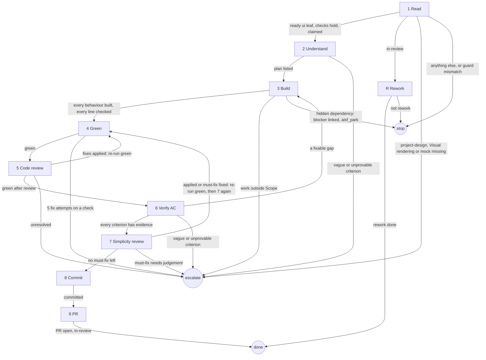

# ui-implement-ticket

## Role and goal

Build one ready `type: ui` leaf to an open PR by render and compare against its mock. An `in-review` ticket goes to `aisf:rework`.

The oracle is the mock: render, look, compare, adjust. TDD keeps behaviour, never geometry.

## Parameters

- `<n>`: the ticket.
- `--since <ISO time>`: passed on to `aisf:rework`.

## General rules

- The ticket is the whole brief. Through step 6, load no `project-architecture` or `project-index`, and read no parent's or sibling's body. `aisf:review-code` checks the architecture in step 5.
- Every status change and issue write goes through `aisf:github-issue`.
- Keep every test as strong as it is. Touch a PR only when green.
- A choice the ticket leaves open, or a contradiction in it, is a decision: make it, list it in the PR's Merge danger.
- Images are never committed or uploaded. `.aisf/` is gitignored: never `git add -f` an image.

## Graph

Escapes inside `aisf:pr` and `aisf:rework` are not drawn: the owner's graph holds them.

## Steps

### 1. Read

- Goal: a ready `type: ui` leaf with its mock and slots, claimed; or an `in-review` ticket handed to rework.
- Actions: read the ticket. A leaf at `status: ready` with `type: ui` and Part, Landing zone, Description, Scope and Acceptance criteria in its body (the body `aisf:ui-ticket` posts). Then check, before the claim: `project-design` loads; `project-testing` has `## Visual rendering`; `.aisf/design/mocks/<part>.html` exists in this worktree, `<part>` from the body's Part. All hold → guard `ready → in-progress`. `in-review` → R.
- Uses: `aisf:github-issue`, Skill tool.
- Done: the ticket is `in-progress`, handed to R, escalated, or the run stopped.
- Exits: ready ui leaf, checks hold, claimed → 2 · `in-review` → R · a check fails → escalate `spec`, naming `project-design`, `## Visual rendering` or the mock path · anything else (no `type: ui` included), or guard mismatch → stop: say why, write nothing.

### 2. Understand

- Goal: a plan of the build.
- Actions: read the leaf and the mock `.aisf/design/mocks/<part>.html`: it is what you build against. Read `.aisf/design/tokens.css`. Load `aisf:tdd`, `project-design` and `project-testing`, plus each skill they name under `## Load also`. List the files, the states, the behaviours and the test for each, and the visual proof per checklist line. Settle every vague criterion's reading now. A leaf that replaces a component: deleting it is part of the job.
- Uses: `aisf:tdd`, `project-design`, `project-testing`.
- Done: every criterion has a test or a proof in the list.
- Exits: plan listed → 3 · a vague or unprovable criterion → escalate `spec`.

### 3. Build

- Goal: every behaviour built by TDD, every checklist line matching the mock or carrying a stated reason, inside Scope.
- Actions:
  - Behaviour: TDD per `aisf:tdd`: what a click or key does, which state a view model describes for each input, callbacks, navigation. Assert behaviour only, never geometry: no padding, radius or colour equality, no counting wrapper elements. Test layout follows `project-testing`.
  - The spec's names, Landing zone and contracts go in verbatim: a sibling builds against them. Scope's Out belongs to a sibling. Hidden dependency (can't finish until another ticket lands): find or post a bare idea for it, `gh issue edit <n> --add-blocked-by <m>`, comment why, `aisf_park`.
  - Render loop: render with the `## Visual rendering` recipe in `project-testing`, once per state the leaf lists, in light and dark. PNGs go to `.aisf/images/`, named `<part>-<state>-light.png` and `<part>-<state>-dark.png`. Render, Read the PNG, compare it with the mock, adjust, render again. Walk the leaf's checklist line by line: matches or doesn't. Tokens from `.aisf/design/tokens.css`, never literals; a colour with no token follows what the leaf decided. Stop when every line matches or has a stated reason it can't. Pixel-perfect is not the goal; an unresolved difference goes to the PR as a known deviation.
- Uses: `aisf:tdd`, `project-testing`, `aisf:github-issue`, `aisf_park`.
- Done: every behaviour has a passing test; every checklist line matches or has a stated reason.
- Output: the PNGs in `.aisf/images/`; the per-line verdicts.
- Exits: every behaviour built, every line checked → 4 · needed work outside Scope → escalate `spec` · hidden dependency, blocker linked → stop via `aisf_park`.

### 4. Green

- Goal: `test` and `analyze` clean.
- Actions: run `test` and `analyze` from `project-toolchain`; read `analyze` as its block says. 5 fix attempts per failing check; a new failure resets the count. Unsure a failure is yours → run the file in a throwaway `git worktree` on `origin/main`. Red there too → not yours: report it, post a bare idea if none exists.
- Uses: `project-toolchain`.
- Done: both clean.
- Exits: green → 5, or back to the step that sent here (5 → 6, 7 → 7) · 5 fix attempts on a check → escalate `red`.

### 5. Code review

- Goal: the architecture checked against the spec.
- Actions: launch one `aisf:review-code` agent whose prompt is the spec, verbatim, nothing else (on a one-PR ticket: the `## Spec` section). Fixed → nothing. Deviates from spec → each in the PR's Merge danger; a `contract` one also gets a comment on every sibling the spec names for it: old name and shape, new one, the rule. Re-run 4; keep its fixes.
- Uses: `aisf:review-code`.
- Done: its result handled, green.
- Exits: fixes applied → 4 · green after review → 6 · unresolved → escalate `spec`.

### 6. Verify AC

- Goal: evidence for every criterion.
- Actions: behaviour → the passing test that asserts it, by name. Command → run it verbatim, show the output; never a test in its place. Visual → a per-line verdict as text, with the image file named. "Matches the mock" is not evidence; "16px padding, `var(--surface)`: matches; dark `--accent` reads heavier than the mock" is. The leaf has no `hitl`: the PR review is the human check.
- Done: every criterion has evidence.
- Output: the evidence for the PR.
- Exits: every criterion has evidence → 7 · a fixable gap → 3 · a vague or unprovable criterion → escalate `spec`.

### 7. Simplicity review

- Goal: the diff simplified.
- Actions: invoke `aisf:review-simplicity` and handle its report as it says.
- Uses: `aisf:review-simplicity`.
- Done: no must-fix left.
- Exits: applied, or must-fix fixed → 4, then 7 again · no must-fix left → 8 · must-fix needs judgement → escalate `spec`.

### 8. Commit

- Goal: one commit.
- Actions: invoke `aisf:commit`.
- Uses: `aisf:commit`.
- Done: committed.
- Exits: committed → 9.

### 9. PR

- Goal: the work shipped, the ticket findable.
- Actions: invoke `aisf:pr` with the step 6 evidence. Evidence names the mock path and each image file in `.aisf/images/`, says the images show on the ticket page, and gives the per-line verdict as text. Merge danger lists every unresolved difference from the mock, and why.
- Uses: `aisf:pr`.
- Done: PR open and ticket `in-review`.
- Exits: → done.

### R. Rework

- Goal: the in-review PR reworked, or left to review.
- Actions: load `aisf:rework` with `--since`. It drives, and uses steps 3, 4, 6 and 8 for its change, check, verify and commit. Step 3 re-renders and replaces the images.
- Uses: `aisf:rework`.
- Done: `aisf:rework` ended.
- Exits: rework done → done · not rework → stop.

## Output

An open PR and the ticket `in-review`, the images in `.aisf/images/` (never committed); or a rework done.
