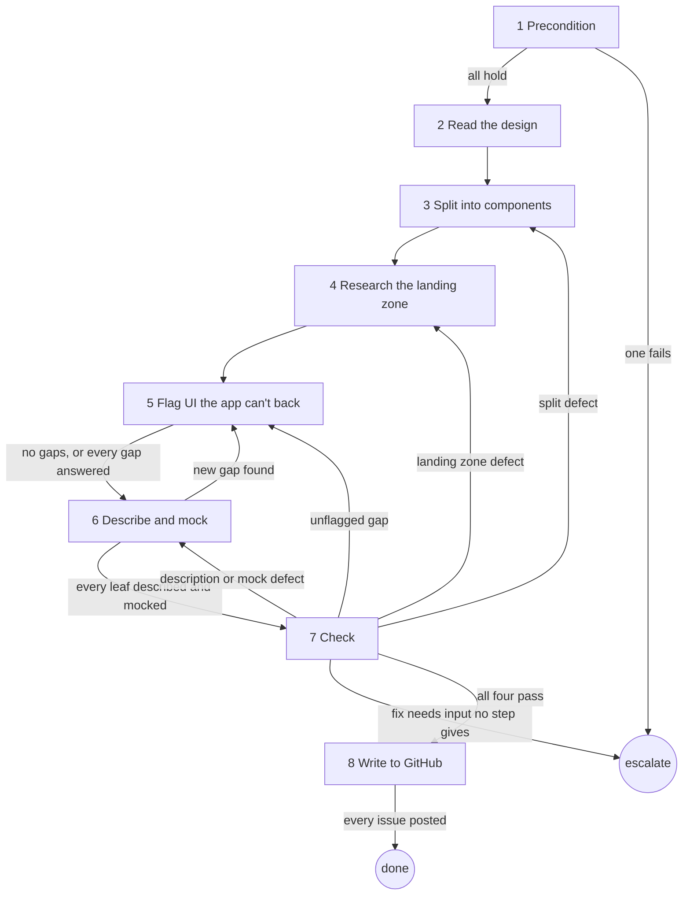

# Role and goal

Turn the accepted design of ticket `<n>` into one `status: ready` leaf per component, each with
its own local mock, built later by `aisf:ui-implement-ticket`. The design is the spec: no
interview.

# Parameters

`<n>`: the ticket number.

# General rules

- Ask the human only about UI the app can't back (step 5). Flag each such piece; never guess.
- Every issue write goes through `aisf:github-issue`.
- Nothing leaves the machine: no `Artifact` tool, no upload. Every mock is a local file.
  `ui-split` (step 5) is the one page shown.

# Graph

# Steps

## 1. Precondition

- **Goal**: the ticket and the design are ready to split.
- **Actions**: check, in order: `<n>` is open with `status: plan`; `project-design` loads
  (Skill tool); `project-testing` has a `## Visual rendering` heading;
  `.aisf/artifacts/design/index.json` exists.
- **Uses**: `gh issue view`, Skill tool.
- **Done**: all four hold.
- **Exits**: one fails → `aisf_escalate` `spec`, naming the missing piece (ticket state, slot,
  heading or path) · all hold → 2.

## 2. Read the design

- **Goal**: know every board, note and token.
- **Actions**: in `.aisf/artifacts/design/` (current worktree), read `index.json` (each
  board's `note` is the designer's voice), `tokens.css` and every `boards/<id>.html`. The HTML
  source carries exact px, order and nesting. Diff the boards: what changes between them is
  the state list each component owes. Elements with `data-annotation` are the designer's
  notes: never built.
- **Done**: every board read; a state list per component.
- **Output**: the state lists.
- **Exits**: → 3.

## 3. Split into components

- **Goal**: one leaf per independently PR-able component.
- **Actions**: one leaf per element with `data-part`. A part inside another is described in
  its container, unless it appears in more than one place. Split along seams, not line
  counts; test: could someone open a PR for this alone and tell from the result whether it is
  right? Containers before contents. A component that needs a half-done sibling → merge the
  two.
- **Done**: every `data-part` is a leaf or described inside one.
- **Output**: the ordered component list.
- **Exits**: → 4.

## 4. Research the landing zone

- **Goal**: each component knows where it lands and what it plugs into.
- **Actions**: read-only on code. Per component: where it lands (exact path, per
  `project-architecture` and `project-design`); add or replace (what it replaces, what gets
  deleted); what exists (view model, route or state it plugs into, whether its data is
  exposed). Prefer reduction: a component an existing one covers with one parameter is a
  modification.
- **Uses**: `project-architecture` (load it here), `project-design`.
- **Done**: every component has the three answers; every missing piece is listed.
- **Output**: landing zones and the gap list.
- **Exits**: → 5.

## 5. Flag UI the app can't back

- **Goal**: the human decides every piece the app can't back today (data nothing exposes, an
  interaction with no receiver, new persistence, a missing navigation target, a whole
  feature).
- **Actions**: ask on one page, id `ui-split`. One question per piece, each with a
  recommendation. Answers: **Scrap** (leave it out, list it as out of scope on `<n>`),
  **Update** (change it so it needs nothing new), **Blocking ticket** (standalone,
  `status: backlog`, `type: enhancement`, not a sub-issue of `<n>`, holding what the UI needs;
  each leaf that needs it is blocked by it). Pieces needing one feature share one blocking
  ticket. Act on no piece before its answer. No gaps → no page.
- **Uses**: `aisf:artifacts`, `aisf_show_artifact`.
- **Done**: every gap has an answer, or there are none.
- **Output**: the answers.
- **Exits**: → 6.

## 6. Describe and mock

- **Goal**: each leaf can be built from its description and mock alone.
- **Actions**:
  - Description: work the checklist, skipping only what does not apply: anatomy, layout,
    dimensions, spacing, colour, typography, shape, iconography, states (default, hover,
    focus, disabled, selected, loading, empty, error), behaviour, responsive. Colour is the
    board's `var(--…)` role token. A `/* NEW */` token in `tokens.css` is a decision: write it
    into that leaf with the board note's reason.
  - Mock: `.aisf/artifacts/design/mocks/<part>.html` (`<part>` = the `data-part` name). Links
    `../tokens.css`. Colours only `var(--…)`. No script, no remote URL. The component alone,
    at real width, every state, light and dark (`data-theme` on each copy). The spec as a
    table below the render. Markup lifted from the board verbatim, not rebuilt.
  - Apply every Scrap and Update answer to the leaf and its mock.
- **Done**: every leaf has a description and a mock.
- **Output**: descriptions; one mock file per leaf.
- **Exits**: a new gap found → 5 · every leaf described and mocked → 7.

## 7. Check

- **Goal**: the run is one-shot, so these checks stand between a bad split and many bad
  tickets.
- **Actions**:
  - **Full coverage**: every visible non-annotation element belongs to exactly one leaf.
  - **Buildable alone**: read each leaf as someone with no memory of the design.
  - **No invented numbers**: every px and token traces to a board or `tokens.css`.
  - **Gaps flagged**: no leaf quietly assumes a route or data that doesn't exist.
- **Done**: all four pass.
- **Exits**: split defect → 3 · landing zone defect → 4 · unflagged gap → 5 · description or
  mock defect → 6 · the fix needs input no step gives (a board, a token, an answer outside
  Scrap, Update, Blocking ticket) → `aisf_escalate` `spec` · all four pass → 8.

## 8. Write to GitHub

- **Goal**: blocking tickets and leaves exist on GitHub; `<n>` is planned.
- **Actions**:
  1. Blocking tickets from step 5.
  2. Leaves, each `--parent <n>`, `type: ui`, `status: ready`, no `hitl`, blocked by its
     blocking tickets and containers. Title is the outcome, not the class name. Body:
     **Context** (one sentence), **Part** (`<part>` and the mock path
     `.aisf/design/mocks/<part>.html`), **Landing zone**, **Description** (step 6 checklist),
     **Scope** with an **Out** list, **Acceptance criteria** (observable outcomes, every
     state).
  3. Guard `plan → planned` on `<n>`. Add the Scrap list as out of scope on `<n>`.
  - No separate verification leaf: each leaf's PR is the human check.
- **Uses**: `aisf:github-issue`.
- **Done**: every blocking ticket and leaf is posted and `<n>` is `planned`.
- **Output**: every number posted, reported.
- **Exits**: → done.

# Output

Blocking tickets, one ready `type: ui` leaf per component with its local mock, `<n>` at
`status: planned`, and every number reported.
