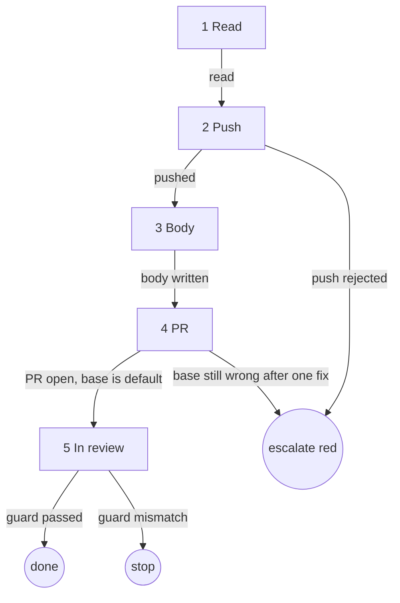
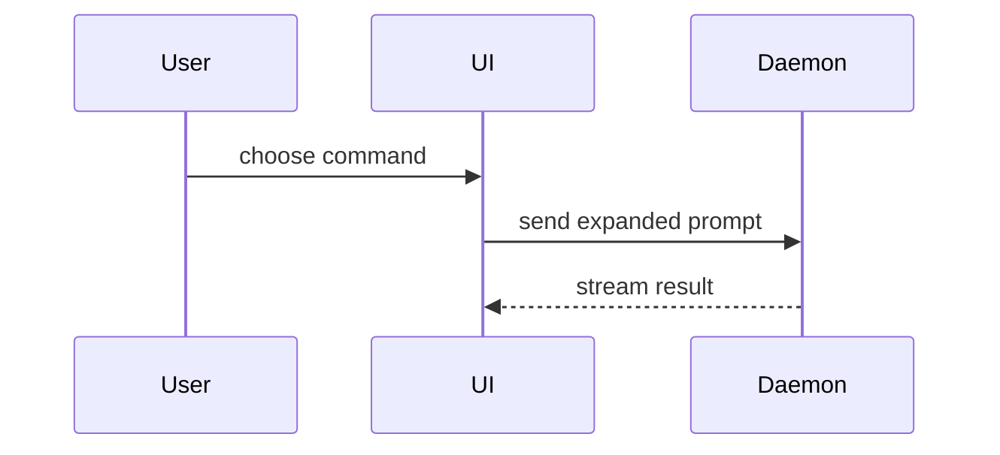

# pr

## Role and goal

Loaded into a builder session once the ticket's work is committed. Ships that work as one open PR against the default branch and moves the ticket to `in-review`, so the ticket is findable.

## Parameters

- `<n>`: the ticket. The session already holds it, the evidence for the body, and whether this is a rework run. No other parameter.

## General rules

- Never merge, never enable auto-merge.
- Never push to the default branch. Never force-push without lease.
- Every issue read and status change goes through `aisf:github-issue`.

## Graph



## Steps

### 1. Read

- Goal: know everything the later steps need.
- Actions: read the ticket's title and `priority:` label; the default branch (`gh repo view --json defaultBranchRef`); `<type>(<scope>)` from the subject of the commit `aisf:commit` made (`git log`); the open PR for the current branch, if any (`gh pr view --json number,url,baseRefName`).
- Uses: `aisf:github-issue`, `gh`, `git log`.
- Done: title, priority, default branch, type and scope known; open PR known or known to be absent.
- Output: these values.
- Exits: `read → 2`.

### 2. Push

- Goal: the branch is on origin.
- Actions: `git push -u origin HEAD`. In a rework run: `git push --force-with-lease`.
- Uses: `git`.
- Done: the remote branch matches `HEAD`.
- Output: the pushed branch.
- Exits: `pushed → 3` · `push rejected → escalate red` (output pasted).

### 3. Body

- Goal: the PR body file.
- Actions: write the body from `origin/<default>...HEAD` and the session's evidence, by the template below (Summary, Evidence, Merge Danger) and its section guidance. Append `Closes #<n>`. A rework run writes it the same way: the body is rewritten, `Closes` kept.
- Uses: the template below.
- Done: the body file has all three sections and `Closes #<n>`.
- Output: the body temp file.
- Exits: `body written → 4`.

### 4. PR

- Goal: one open, non-draft PR against the default branch, with the priority label.
- Actions: an open PR exists → `gh pr edit <pr> --body-file <tmp> --add-label "priority: <x>"`. Else `gh pr create --body-file <tmp> --label "priority: <x>" --base <default>`, title `<type>(<scope>): <ticket title>`, not draft. Then read the base; wrong → `gh pr edit <pr> --base <default>`, read again.
- Uses: `gh`.
- Done: the PR is open, not draft, has the priority label, base is the default branch.
- Output: the PR number and URL.
- Exits: `PR open, base is default → 5` · `base still wrong after one fix → escalate red`.

### 5. In review

- Goal: the ticket is findable as in review.
- Actions: guarded `in-progress → in-review`. Never skip it: it makes the ticket findable. Report the PR URL in one line.
- Uses: `aisf:github-issue` (guarded transitions).
- Done: the ticket is `in-review`.
- Output: the PR URL line.
- Exits: `guard passed → done` · `guard mismatch → stop`, report the actual state.

## Output

One open PR against the default branch, with the body, `Closes #<n>` and the priority label. The ticket is `in-review`. The PR URL reported in one line.

## Body template

Step 3's reference.

Use this template for the PR body:

```markdown
## Summary

<diagram, diff-sketch, or tree>

## Evidence

- **Before:** <screenshot>
  **After:** <screenshot>

## Merge Danger

**Door:** <one-way or two-way>

<optional: description>

**Blast Radius:** <one-word description>

<optional: potential ramifications of merge>
```

## Sections

Skip all preambles and keep prose brief.

### Summary

Pick the smallest view that makes the key point clear.

- Show logic or an algorithm as pseudocode:

```text
on(save)
  if content is unchanged
    return cached result
  write new content
  return fresh result
```

- Show runtime control flow as a call tree:

```text
submitForm
  createSession
    persistPrompt
    launchAgent
  navigateToSession
```

- Show UI structure as a component tree, including state and module boundaries that matter:

```text
<SessionPage> (apps/example/src/routes/session.tsx)
  useSessionEvents()
  <SessionToolbar>
    <RunSkillButton> (packages/ui)
```

- Show file responsibility or a broad refactor as a shallow file tree:

```text
src/
├── commands/       # parses user actions
├── sessions/       # owns session state
└── transport/      # sends API requests
```

- Show component interaction, control flow, or data flow with Mermaid:



- Use `diff` when the point is what changes and the surrounding shape already exists. Match the diff shape to the topic.

For a component change:

```diff
 <SessionPage>
   useSessionEvents()
   <SessionToolbar>
+    <RunSkillButton />
   <SessionTimeline>
+    <SkillResultCard />
```

For a file-layout change:

```diff
 src/
 ├── commands/
+│   └── show-me.ts       # expands the slash command
 ├── sessions/
-└── transport.ts
+└── transport/
+    ├── client.ts
+    └── stream.ts
```

For a call-tree or call-stack change:

```diff
 submitForm
   createSession
     persistPrompt
+    expandSkillMention
     launchAgent
-  navigateToSession
+  navigateToSession
+    subscribeToEvents
```

For a state or control-flow change:

```diff
 on(save)
-  write content
+  if content is unchanged
+    return cached result
+  write new content
+  invalidate cache
```

- Show the whole block when most of it is new, when omitted context would hide ownership or order, or when the reader needs a copyable target shape:

```ts
function expandSkill(command: string): string {
  const skillName = command.slice(1);
  return `use the ${skillName} skill`;
}
```

#### Guidance

Place each visual next to the short text it supports. Keep only the calls, files, props, states, and boundaries needed to make the point.

You may use one of these, you may use several, it is unlikely you will use all of them. Use your judgement and don't overwhelm the reader.

### Evidence

Concrete evidence that the change works.

Screenshots are S-tier - when the environment is set up for it and the change is visual. Show Before and After.

Execution-based evidence is A-tier. Show the exact test that now fails and passes, using pseudocode, plus the verbatim command output. No Before/After pair needed.

### Merge Danger

Describe whether it's a one-way or two-way door. You can walk back through two-way doors, but not one-way doors. A PR that is cheap to roll back is lower risk. Changes that involve destructive actions or hard-to-reverse decisions are one-way doors.

The blast radius is the potential impact or scope of the changes introduced by this PR. Consider all possibilities. Examples are layout shift, breakages for consumers, mobile responsiveness, etc.
