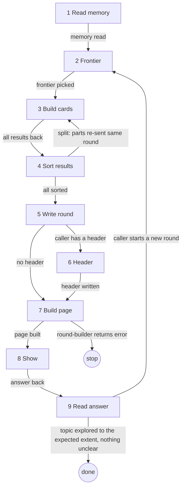

# Role and goal

The entry point for asking the human in rounds on one bridge page. It names the three builder agents: `question-builder`, `round-builder`, `playback-builder`. It is loaded into the calling skill's session, so the caller runs the steps itself. The calling skill owns its questions, its stance, its page id and its ledger line format; this skill owns how the asking works.

# Parameters

From the calling skill:

- `<page-id>`: the page id. Folder `.aisf/artifacts/<page-id>/`.
- stance: one line on how technical the cards are.
- its questions and its ledger line format.
- a header: only a caller that has one runs step 6.

# General rules

- Facts are yours: look them up, or send an agent. Decisions are the human's.
- One bridge page per session. Chat gets no questions. The caller shows the page itself, never from an agent.
- Files are the memory. Later steps read `ledger.md` and `findings.md`, not the scrollback, so a compacted context loses nothing.
- The page is a decision device: disposable, never linked from GitHub.
- Each agent's input and rules are in its own file (`agents/`).

# Graph

# Steps

## 1. Read memory

- Goal: know every settled decision before asking.
- Actions: read `ledger.md` and `findings.md` in `.aisf/artifacts/<page-id>/` (absent: empty). A resumed session asks only what is still open.
- Uses: Read.
- Done: every settled decision and known fact is in view.
- Exits: `memory read → 2`.

## 2. Frontier

- Goal: pick what to ask this round.
- Actions: map the decisions as a design tree. The frontier is every open decision whose prerequisites are settled; ask it all in one round. A decision that depends on an open one waits. Give each rough options.
- Uses: Read, Grep, research agents for facts.
- Done: every frontier decision has a name and rough options, and none depends on an open one.
- Output: the round's question list.
- Exits: `frontier picked → 3`.

## 3. Build cards

- Goal: one card per question.
- Actions: launch one `question-builder` per question, in parallel: page id, name, question, rough options, the caller's stance.
- Uses: agent `question-builder`.
- Done: every question has a result.
- Output: per question `card`, `settled` or `split`.
- Exits: `all results back → 4`.

## 4. Sort results

- Goal: turn the results into the round.
- Actions: `card` → it goes in the round. `settled` → a precedent row. `split` → send the parts out again in the same round; a part that depends on another waits a round.
- Done: every result is a card, a row, or waits for a later round.
- Output: card names and rows.
- Exits: `split: parts re-sent same round → 3` · `all sorted → 5`.

## 5. Write round

- Goal: hand the round to the build.
- Actions: the caller writes `.aisf/artifacts/<page-id>/round-<N>.json` before the build. Contract in `agents/round-builder.md`.
- Uses: Write.
- Done: `round-<N>.json` exists.
- Output: `round-<N>.json`.
- Exits: `caller has a header → 6` · `no header → 7`.

## 6. Header

- Goal: keep the page header in step with the ledger.
- Actions: run `playback-builder` (`n`, page id, `N`).
- Uses: agent `playback-builder`.
- Done: `header.html` written.
- Output: `header.html`.
- Exits: `header written → 7`.

## 7. Build page

- Goal: add the round to the one page.
- Actions: run `round-builder` (page id, `N`, the absolute path of `build-page.mjs` in this folder).
- Uses: agent `round-builder`.
- Done: `round-builder` returns `result: page`.
- Output: `index.html`.
- Exits: `page built → 8` · `round-builder returns error → stop` (report its reason).

## 8. Show

- Goal: get the human's answer.
- Actions: call `aisf_show_artifact` yourself with the page id. Read `aisf:artifacts` first.
- Uses: tool `aisf_show_artifact`, skill `aisf:artifacts`.
- Done: the event or a plain-text answer is back.
- Exits: `answer back → 9`.

## 9. Read answer

- Goal: turn the answer into memory and decide what comes next.
- Actions: read it as `aisf:artifacts` says. Append the ledger in the caller's line format; `assumes` lives in the ledger only, never on a card. A free-text answer that cannot be read clearly becomes a follow-up question next round. Then do whatever the calling skill needs, and start a new round whenever it chooses.
- Uses: skill `aisf:artifacts`.
- Done: the ledger holds every answer of the round.
- Output: ledger lines.
- Exits: `caller starts a new round → 2` · `topic explored to the expected extent, nothing unclear → done`.

# Output

In `.aisf/artifacts/<page-id>/`: `index.html` (all rounds), one `round-<N>.json` per round, `ledger.md`, `findings.md`, and `header.html` for a caller with a header.
