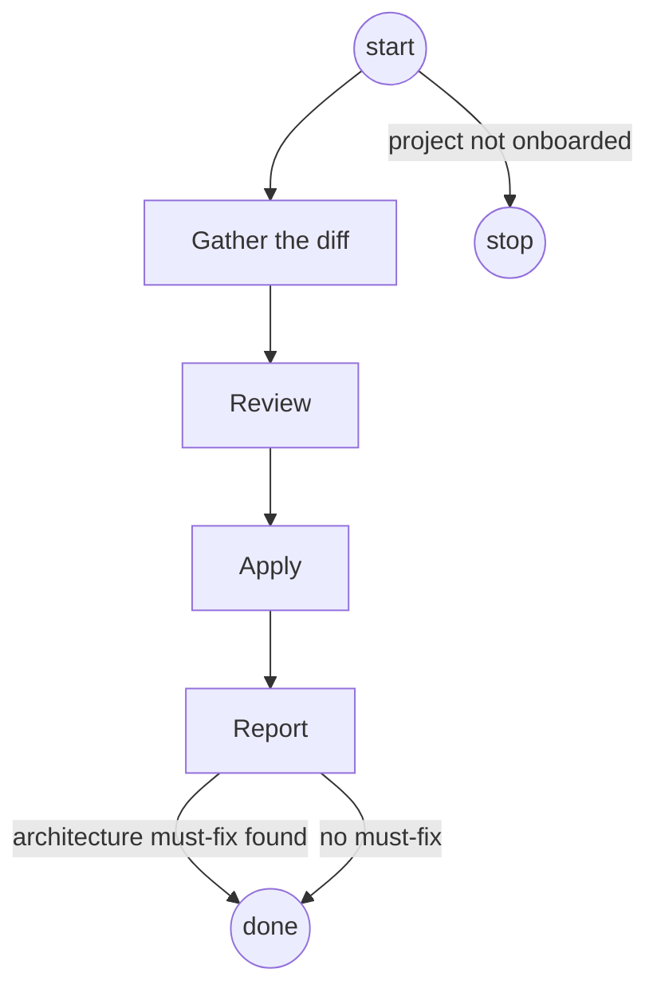

# review-simplicity

## Role and goal

Post-implementation simplicity review of the working diff. Runs after AC verification, before
commit. No user interaction: the calling agent decides alone what to apply.

## Parameters

None. Reads the working diff.

## General rules

- Load `project-architecture` and `project-toolchain` with the Skill tool (bare names). Either
  returns `Unknown skill` → stop, report "project not onboarded".

## Graph

## Steps

### 1. Gather the diff

- **Goal**: the diff about to be committed.
- **Actions**: `git diff HEAD` plus `git status --porcelain` for new files. In a rework run it is
  only the rework diff.
- **Done**: the diff and the new-file list are in hand.
- **Exits**: `→ 2`

### 2. Review

- **Goal**: findings on every angle group.
- **Actions**: launch `aisf:simplicity-reviewer` agents in one message, one per angle group
  below. Give each the diff from step 1 and the file path of every skill `project-architecture`
  names under `## Load also` (find them with Glob, e.g. `**/skills/<name>/SKILL.md`), so the
  agent can Read them. The agent has `project-architecture` preloaded and cannot edit.
  - **Simplicity (four angles)**
    - **Reuse** — new code that reimplements something the codebase already has, including
      shared code where `project-architecture` says it lives.
    - **Simplification** — redundant/derivable state, copy-paste variants, deep nesting, dead
      code, needless complexity (indirection, abstraction, or generality nothing in the diff
      needs — a wrapper used once, a config knob with one caller, a class where a function would
      do).
    - **Efficiency** — wasted work: redundant computation, sequential independent operations,
      closures/objects capturing more of their environment than they need.
    - **Altitude** — a special case layered on shared infrastructure instead of fixing the
      mechanism at the right depth, as `project-architecture` places it.

    A finding only belongs here if applying it changes nothing observable: same test results,
    same ACs, same visible behavior. A fix that would change behavior isn't a simplicity
    finding — route it to Bugs & gaps instead.

  - **Architecture**
    - A change in the diff that breaks a rule in `project-architecture`'s `references/rules.md`.
      Each finding names the rule number it breaks.

    Returned to the caller as must-fix. Never applied by this skill.

  - **Bugs & gaps**
    - **Bug** — noticed while reading the diff, not caught by the ticket's tests.
    - **Gap** — functionality that reads like an obvious part of the ticket's intent but isn't
      covered by an AC.

    Report-only. Never applied by this skill.
- **Uses**: agent `aisf:simplicity-reviewer`, Glob.
- **Done**: every agent has returned.
- **Output**: the findings, in the agent's own return fields.
- **Exits**: `→ 3`

### 3. Apply

- **Goal**: apply only the simplicity findings certain to change nothing observable.
- **Actions**: take the commands from the `aisf-toolchain` block in `project-toolchain`. For
  each simplicity finding, apply it only if certain it changes nothing behavioral or visual and
  tests will stay green. After applying a batch, re-run the affected tests with `test_file`,
  then the full suite with `test`, then `analyze`. Not certain → discard silently, no
  explanation owed per item. A fix that breaks a test or `analyze` is reverted, not patched
  further. Architecture and bug/gap findings are never applied here: the caller fixes
  architecture findings, and fixing a bug is a behavior change outside scope.
- **Uses**: `project-toolchain` commands `test_file`, `test`, `analyze`.
- **Done**: every simplicity finding is applied or discarded; `test` and `analyze` are green; no
  finding is half-applied.
- **Exits**: `→ 4`

### 4. Report

- **Goal**: one short block for the caller.
- **Actions**: report each bug or gap through `aisf_report_finding` (`kind` bug or gap,
  `location` file:line, `summary`). Write the block:
  - **Applied** — count, and one line each: `file:line` — what changed.
  - **Discarded** — count only.
  - **Architecture (must-fix)** — one line each: `file:line` — the rule broken. The caller
    fixes each, re-runs green, then runs `aisf:review-simplicity` again. A fix that needs a
    judgement call is escalated, not guessed.
  - **Bugs/gaps** — count only. The caller puts the count in the PR's Merge danger.
  - A category with nothing found → omit its line.
- **Uses**: tool `aisf_report_finding`.
- **Done**: every bug and gap went through the tool; the block is written.
- **Output**: the Report block.
- **Exits**: `architecture must-fix found → done` (the caller fixes and invokes again) · `no must-fix → done`

## Output

Applied simplifications in the working tree, bugs and gaps stored by `aisf_report_finding`, and
the Report block.
