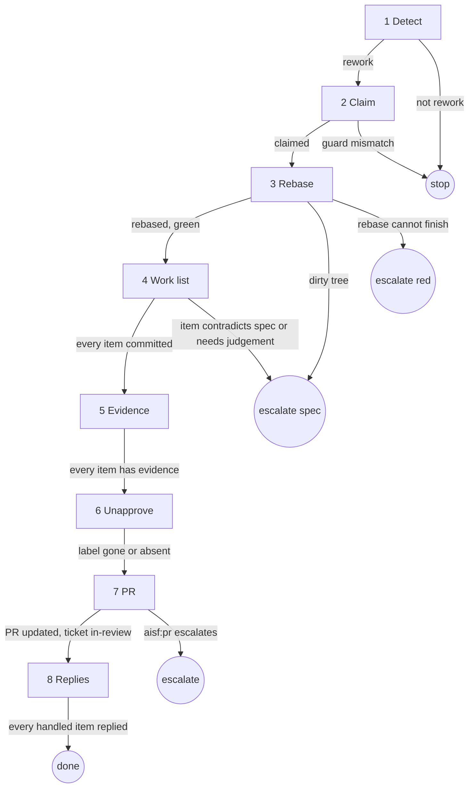

# rework

## Role and goal

Read by the running builder (`implement-ticket`, `ui-implement-ticket`, `skill-implement-ticket`) as an extension of its own process, whenever its ticket is `in-review`. Each step below replaces the builder's step of the same role.

Goal: decide whether this is rework. If it is: every review item handled, the PR updated in place, the ticket back in `in-review`. If not: stop, write nothing; it waits on review.

## Parameters

- `<n>`: the ticket. The builder holds it.
- `--since <ISO time>`: when the app's last run ended. Only rework uses it.
- The PR is found by step 1, not handed in.

## General rules

- Every status change and issue write goes through `aisf:github-issue`.
- Every escalate is `aisf_escalate`.
- Rebase, never merge `origin/main` in: a merge commit blocks the app's rebase-merge.
- A review thread is the reviewer's to resolve.

## Graph

## Steps

### 1. Detect

- Goal: decide whether the in-review ticket is rework.
- Actions: find the PR via `closedByPullRequestsReferences`. It is rework when exactly one open PR exists, it has no `approved` label unless it conflicts, and at least one holds:
  - it conflicts with `origin/main` (GitHub `mergeable` is `CONFLICTING`; `UNKNOWN` counts as no conflict, as in the app),
  - it has review activity after `--since` (a review with text or comments, or a PR conversation comment); without `--since` this trigger does not apply,
  - it has unresolved review threads.
- Uses: `aisf:github-issue` (issue read), `gh pr view`, `gh api graphql` (`reviewThreads`).
- Done: rework or not rework is decided.
- Output: the PR number, and which triggers hold.
- Exits: `rework → 2` · `not rework → stop`, write nothing: it waits on review.

### 2. Claim

- Goal: the ticket is `in-progress`.
- Actions: guarded `in-review → in-progress`.
- Uses: `aisf:github-issue`.
- Done: the ticket is `in-progress`.
- Output: the claimed ticket.
- Exits: `claimed → 3` · `guard mismatch → stop`.

### 3. Rebase

- Goal: the current branch rebased on `origin/main`, checks green.
- Actions: `git status --porcelain`; non-empty → escalate `spec`, naming the dirty files. Else `git fetch origin`, `git rebase origin/main` on the current branch. Then the builder's check step.
- Uses: `git`, the builder's check step, `aisf_escalate`.
- Done: the branch is rebased and the builder's checks are green.
- Output: the rebased branch.
- Exits: `rebased, green → 4` · `dirty tree → escalate spec` · `rebase cannot finish → escalate red`.

### 4. Work list

- Goal: every review item changed, green and committed.
- Actions: list each unresolved review thread (keep each comment's `databaseId`), each review body and PR conversation comment created after `--since` (none without `--since`), failing checks, conflicts. Per item: the builder's change-and-check step, then its commit step, so each item has its own commit. Track item → SHA. A rebase alone needs no new commit.
- Uses: `gh api graphql` (`reviewThreads`), `gh pr view`, `gh pr checks`, the builder's change, check and commit steps.
- Done: every item is changed, green and committed, and the item → SHA list is written.
- Output: the item → SHA list.
- Exits: `every item committed → 5` · `item contradicts the spec or needs a judgement call → escalate spec`.

### 5. Evidence

- Goal: proof for every item.
- Actions: in the builder's verify step, every work-list item gets evidence beside the criteria.
- Uses: the builder's verify step.
- Done: every item has one evidence line.
- Output: the evidence lines, for the PR body.
- Exits: `every item has evidence → 6`.

### 6. Unapprove

- Goal: the human re-approves the reworked PR. The app auto-merges an `in-review` PR with `approved`, so the label must go before step 7 moves the ticket to `in-review`.
- Actions: if the PR has the `approved` label: `gh pr edit <pr> --remove-label approved`.
- Uses: `gh`.
- Done: the PR has no `approved` label.
- Exits: `label gone or absent → 7`.

### 7. PR

- Goal: the PR updated in place and the ticket `in-review`.
- Actions: load `aisf:pr` as a rework run. It pushes with lease, rewrites the body with the evidence and `Closes #<n>`, and moves the ticket to `in-review`. No new PR.
- Uses: `aisf:pr`.
- Done: `aisf:pr` is done: PR updated, ticket `in-review`.
- Output: the PR URL.
- Exits: `PR updated, ticket in-review → 8` · `aisf:pr escalates → escalate`.

### 8. Replies

- Goal: every reviewer knows what changed, by a SHA that is on GitHub.
- Actions: reply under each handled review comment with what changed and its SHA (`gh api repos/{owner}/{repo}/pulls/<pr>/comments/<databaseId>/replies -f body=…`). A handled review body or conversation comment gets one PR comment quoting it, with its SHA. Re-request review from every reviewer whose item was handled.
- Uses: `gh api`, `gh pr edit --add-reviewer`.
- Done: every handled item has a reply, and review is re-requested from each of their reviewers.
- Output: the replies.
- Exits: `every handled item replied → done`.

## Output

Rework: the PR updated in place (one commit per item, rebased, pushed with lease, body rewritten), no `approved` label, a reply per handled item with its SHA, review re-requested, the ticket `in-review`. Not rework: nothing written.
